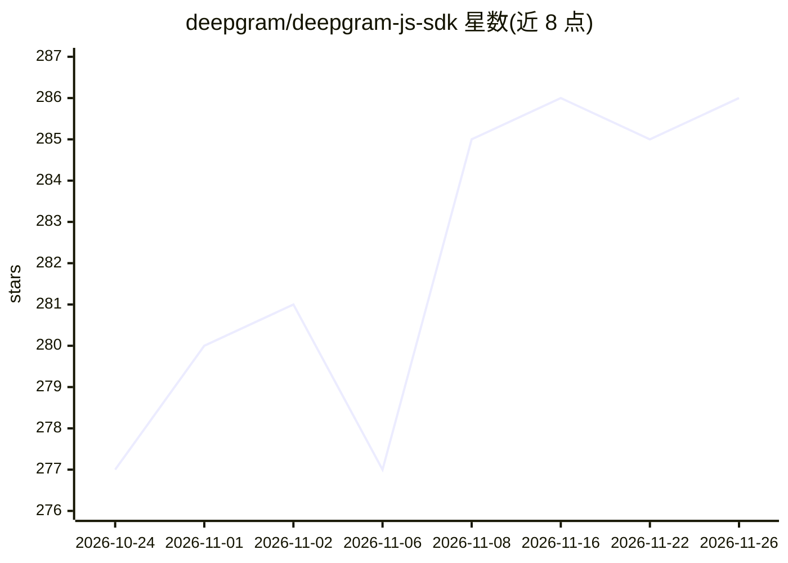

# deepgram/deepgram-js-sdk

⭐ 286 · TypeScript · MIT · 推送 2026-11-25 · [GitHub](https://github.com/deepgram/deepgram-js-sdk) · [官网](https://developers.deepgram.com) · 组织维护

**开发者接入 Deepgram 语音识别/TTS/语音代理 API 的官方 JS SDK**

Deepgram 官方的 JavaScript/TypeScript SDK，封装其语音识别（实时流式与文件转写）、文本转语音、文本分析与语音代理（Voice Agent）API。基于 Fern 生成 REST 客户端，另提供 WebSocket 流式客户端，支持事件回调与 for-await 异步迭代两种消费方式、AbortSignal 取消、自动重连策略配置、自定义 HTTP 代理与 fetch 实现。认证支持 API Key、访问令牌与环境变量自动发现，并导出完整 TypeScript 请求/响应类型。需要 Node.js 18+ 及 Deepgram API Key。

## 筛选速览

| 维度 | 判定 | 备注 |
|---|---|---|
| AI 角色 | `ai-ecosystem` | LLM/agent 周边工具 |
| 许可风险 | `permissive` | MIT |
| 部署形态 | `library` | 以包/库形式分发 |
| 模型依赖 | — | README 未给出锁定关系 |
| 硬件要求 | — | 无带数字的原话,不猜 |
| 安装摩擦 | `low` | 无编译、无系统依赖或容器化 |
| 成熟度 | — | 结构信号不足 |

## 动量与使用信号

- 安装:github 包 `release-assets` 月下载无数据

## 能力要点

- 覆盖 STT v1/v2（Flux）、TTS v1/v2（Flux）、Voice Agent v1 的流式 WebSocket 客户端与类型化发送方法
- 流式连接支持 async iterable 消费，带 1,000 条/16 MiB 队列上限保护
- AbortSignal 取消、自定义重连策略、自定义 fetch 与 https-proxy-agent 代理支持
- 支持 Node.js 18+/Deno/Bun/Cloudflare Workers/Vercel/React Native 等运行时

## 适用场景

- 在 Node 或浏览器应用中接入实时语音转写
- 为应用生成文本转语音输出
- 构建可对话的语音代理（Voice Agent）
- 对文本做情感、话题与意图分析

## 场景标签

`语音识别` `语音合成` `语音 Agent` · 领域:对话与助手

## 证据(README 行号)

> L8: The official JavaScript/TypeScript SDK for Deepgram's automated speech recognition, text-to-speech, and language und
> L44: |Voice Agent v1|`client.agent.v1.connect()` or `.createConnection()`|`sendSettings`, `sendUpdateListen`, `sendUpdat

## 星数曲线

2026-10-24 277 → 2026-11-26 286（+9）

---
*卡片 v1 · prompt 1.4 · 生成 2026-11-25 · 置信度 high · 依据 README sha `51fd65d1f06a` · [字段定义](../../DATASET.md)*
