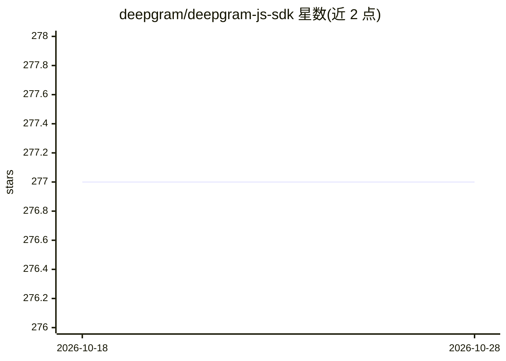

# deepgram/deepgram-js-sdk

⭐ 277 · TypeScript · MIT · 推送 2026-10-27 · [GitHub](https://github.com/deepgram/deepgram-js-sdk) · [官网](https://developers.deepgram.com) · 组织维护

**Deepgram 官方 JS/TS SDK：接入语音识别、合成与语音 Agent API**

Deepgram 官方 JavaScript/TypeScript SDK，封装其自动语音识别（STT）、文本转语音（TTS）、文本分析与 Voice Agent API。提供 REST 与流式 WebSocket 客户端（listen.v1/v2、speak.v1/v2、agent.v1），支持连接管理与自动重连、AbortSignal 取消、异步迭代消费、类型化发送方法及 TypeScript 类型导出。认证支持 API Key 与 Access Token（含环境变量自动发现），浏览器端 REST 需代理。支持 Node 18+、Vercel、Cloudflare Workers、Deno、Bun、React Native 运行时。

## 筛选速览

| 维度 | 判定 | 备注 |
|---|---|---|
| AI 角色 | `ai-ecosystem` | LLM/agent 周边工具 |
| 许可风险 | `permissive` | MIT |
| 部署形态 | `library` | 以包/库形式分发 |
| 模型依赖 | — | README 未给出锁定关系 |
| 硬件要求 | — | 无带数字的原话,不猜 |
| 安装摩擦 | `low` | 无编译、无系统依赖或容器化 |
| 成熟度 | — | 结构信号不足 |

## 动量与使用信号

- 安装:github 包 `release-assets` 月下载无数据

## 能力要点

- 流式 WebSocket 客户端覆盖 STT/TTS/Voice Agent，支持重连策略与 AbortSignal 取消
- 流式连接可作为 async iterable 消费（for await）
- 认证支持 API Key 与 Access Token，自动读取环境变量
- 兼容 Node 18+/Vercel/Cloudflare Workers/Deno/Bun/React Native

## 适用场景

- 在 Node 或浏览器应用中接入 Deepgram 实时语音转文字
- 生成文本转语音或构建对话式语音 Agent
- 批量转写预录制的音频文件

## 场景标签

`语音识别` `语音合成` `语音 Agent` · 领域:对话与助手

## 证据(README 行号)

> L8: The official JavaScript/TypeScript SDK for Deepgram's automated speech recognition, text-to-speech, and language und
> L58: The Deepgram SDK provides clients for all major use cases:

## 星数曲线

2026-10-18 277 → 2026-10-28 277（+0）

---
*卡片 v1 · prompt 1.4 · 生成 2026-10-18 · 置信度 high · 依据 README sha `aa0cb60131e5` · [字段定义](../../DATASET.md)*
