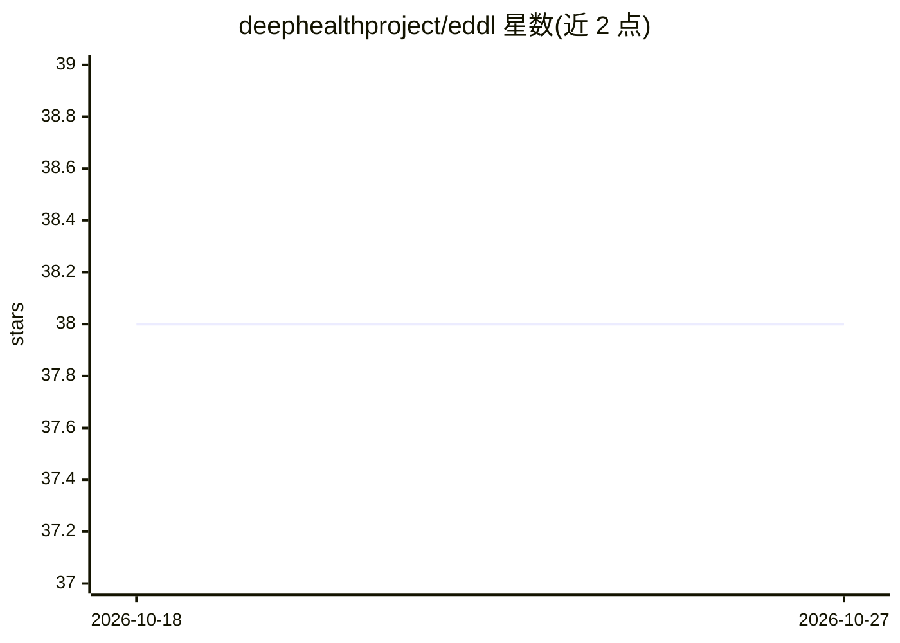

# deephealthproject/eddl

⭐ 38 · C++ · MIT · 推送 2026-07-10 · [GitHub](https://github.com/deephealthproject/eddl) · [官网](https://deephealthproject.github.io/eddl/) · 组织维护

**C++ 分布式深度学习与张量运算库（CPU/GPU/FPGA）**

EDDL 是面向分布式深度学习与张量运算的 C++ 开源库，支持 CPU、GPU 与 FPGA 三类硬件，在欧盟 DeepHealth 项目内开发，初期覆盖医疗场景的深度学习需求。项目自述当前处于追求跨平台稳定安装的阶段，功能覆盖与性能优化分别为中短期与长期目标。README 提供安装与入门入口链接及文档链接，非 C++ 用户可使用其 Python 封装 PyEDDL。

## 筛选速览

| 维度 | 判定 | 备注 |
|---|---|---|
| AI 角色 | `ai-native` | 本体是模型或模型工具 |
| 许可风险 | `permissive` | MIT |
| 部署形态 | `None` |  |
| 模型依赖 | — | README 未给出锁定关系 |
| 硬件要求 | — | 无带数字的原话,不猜 |
| 安装摩擦 | `low` | 无编译、无系统依赖或容器化 |
| 成熟度 | `idea` | |

## 能力要点

- C++ 实现的深度学习与张量运算库
- 支持 CPU、GPU 与 FPGA
- 提供 Python 封装 PyEDDL
- DeepHealth 项目内开发，面向医疗用例

## 适用场景

- 在 C++ 项目中构建和训练神经网络
- 医疗影像等医疗场景的深度学习开发
- 需要跨 CPU/GPU/FPGA 运行的张量计算

## 场景标签

`模型训练` · 领域:训练与推理

## 证据(README 行号)

> L8: **EDDL** is an open source library for Distributed Deep Learning and Tensor Operations in C++ for **CPU**, **GPU** a
> L28: If you are not a C++ fan, try PyEDDL, a python wrapper for this library.

## 星数曲线

2026-10-18 38 → 2026-10-27 38（+0）

---
*卡片 v1 · prompt 1.4 · 生成 2026-10-25 · 置信度 high · 依据 README sha `da21f1556a81` · [字段定义](../../DATASET.md)*
