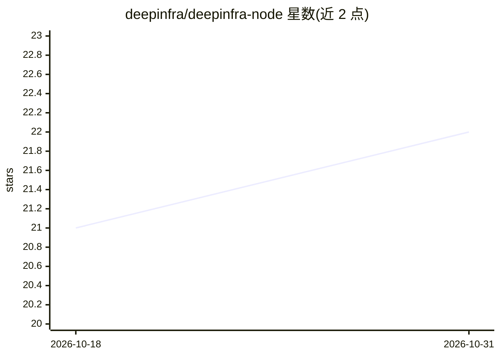

# deepinfra/deepinfra-node

⭐ 22 · TypeScript · MIT · 推送 2026-09-01 · [GitHub](https://github.com/deepinfra/deepinfra-node) · [官网](https://deepinfra.com/) · 组织维护

**DeepInfra 推理 API 的官方 TypeScript 客户端库**

DeepInfra 官方维护的 TypeScript/JavaScript SDK，封装 DeepInfra Inference API：支持文本生成、文本嵌入、SDXL 及文本生成图像、语音识别、目标检测、token 分类、填充掩码、图像分类、零样本图像分类、文本分类等模型调用，均需 DeepInfra API key。另提供 Sandbox 功能，可创建隔离 Linux microVM 运行 bash/python 并在 /workspace 持久化文件，错误类型化处理。通过 npm 安装，MIT 许可。

## 筛选速览

| 维度 | 判定 | 备注 |
|---|---|---|
| AI 角色 | `ai-ecosystem` | LLM/agent 周边工具 |
| 许可风险 | `permissive` | MIT |
| 部署形态 | `library` | 以包/库形式分发 |
| 模型依赖 | — | README 未给出锁定关系 |
| 硬件要求 | — | 无带数字的原话,不猜 |
| 安装摩擦 | `low` | 无编译、无系统依赖或容器化 |
| 成熟度 | — | 结构信号不足 |

## 能力要点

- 覆盖 10 类模型任务的 API 封装（文本生成/嵌入/图像/语音/检测/分类）
- Sandbox 隔离 Linux microVM，支持 bash/python 执行与 /workspace 持久化
- 类型化错误（AuthenticationError/RateLimitError/CapacityError 等）
- 官方维护，npm 安装

## 适用场景

- 在 Node.js 项目中调用 DeepInfra 托管的 LLM 与多模态模型
- 通过 SDK 创建隔离沙箱执行代码任务
- 为应用集成文本嵌入、语音识别或图像生成能力

## 场景标签

`模型网关` · 领域:Agent 开发

## 证据(README 行号)

> L5: This library provides a simple way to interact with the DeepInfra API.
> L61: ## Usage

## 星数曲线

2026-10-18 21 → 2026-10-31 22（+1）

---
*卡片 v1 · prompt 1.4 · 生成 2026-10-28 · 置信度 high · 依据 README sha `7389002c46d1` · [字段定义](../../DATASET.md)*
