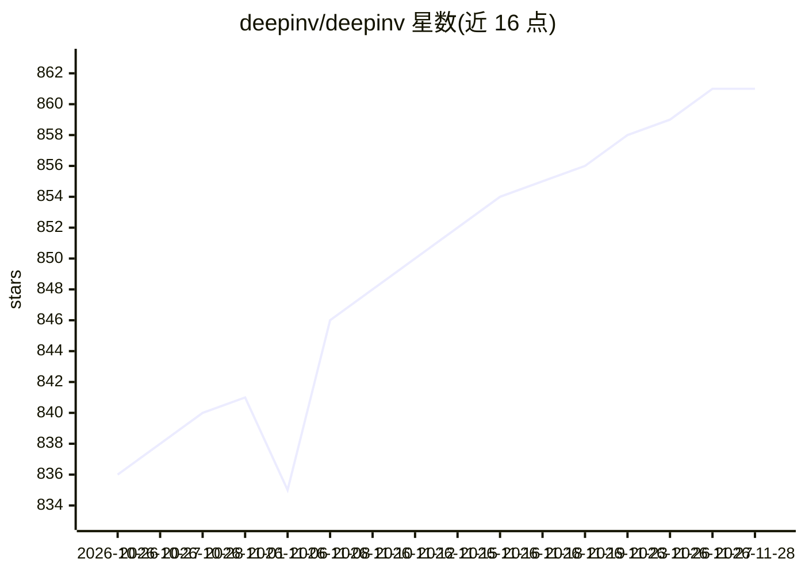

# deepinv/deepinv

⭐ 861 · Python · BSD-3-Clause · 推送 2026-11-27 · [GitHub](https://github.com/deepinv/deepinv) · [官网](http://deepinv.org/) · 组织维护

**面向成像研究者的深度学习逆问题求解 PyTorch 库**

DeepInverse 是基于 PyTorch 的开源成像逆问题求解库，为跨成像领域的深度学习研究提供统一模块化框架：涵盖预定义成像算子、预训练重建模型与去噪器、即插即用复原与优化框架、逆问题训练损失、用于不确定性量化的采样与扩散模型，以及数据集构建框架。定位为加速成像领域深度学习研究、提升可复现性并降低新手上手门槛。以 pip 安装，要求 Python 3.11+，官方文档与快速入门教程齐备，由社区驱动维护，有 JOSS 论文可供引用。

## 筛选速览

| 维度 | 判定 | 备注 |
|---|---|---|
| AI 角色 | `ai-native` | 本体是模型或模型工具 |
| 许可风险 | `permissive` | BSD-3-Clause |
| 部署形态 | `library` | 以包/库形式分发 |
| 模型依赖 | — | README 未给出锁定关系 |
| 硬件要求 | — | 无带数字的原话,不猜 |
| 安装摩擦 | `low` | 无编译、无系统依赖或容器化 |
| 成熟度 | — | 结构信号不足 |

## 能力要点

- 预定义成像算子框架与开箱即用的预训练重建模型、去噪器
- 即插即用复原、优化与展开架构的求解框架
- 面向逆问题的训练损失与数据集构建框架
- 用于不确定性量化的采样算法与扩散模型

## 适用场景

- MRI、显微、医学影像等领域的图像重建研究
- 图像去噪、去模糊等复原任务的模型训练与评估
- 为逆问题搭建自监督训练的数据集与损失函数

## 场景标签

`图像视频处理` · 领域:感知与多模态

## 证据(README 行号)

> L11: `DeepInverse <https://deepinv.org>`_ is an open-source PyTorch-based library for solving imaging inverse problems w
> L27: * Many `state-of-the-art deep neural networks <https://deepinv.org/user_guide/reconstruction/introduction.html>`_, 

## 星数曲线

2026-10-26 836 → 2026-11-28 861（+25）

---
*卡片 v1 · prompt 1.4 · 生成 2026-11-28 · 置信度 high · 依据 README sha `418dbe567cd5` · [字段定义](../../DATASET.md)*
