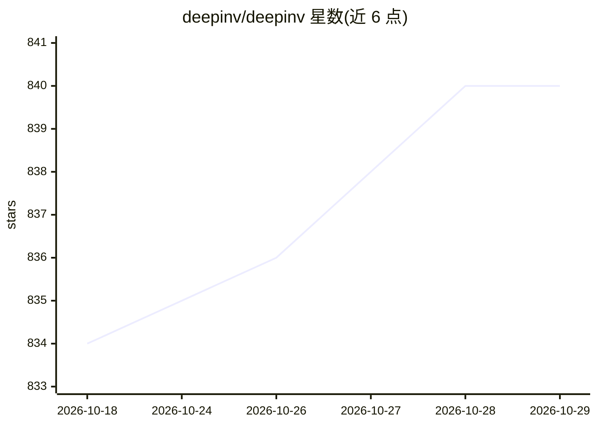

# deepinv/deepinv

⭐ 840 · Python · BSD-3-Clause · 推送 2026-10-28 · [GitHub](https://github.com/deepinv/deepinv) · [官网](http://deepinv.org/) · 组织维护

**PyTorch 成像逆问题求解库：深度学习重建/去噪/去模糊**

基于 PyTorch 的开源成像逆问题求解库，属 PyTorch 官方生态。提供预定义成像算子、即用的预训练重建模型与去噪器、即插即用恢复、优化与展开架构、逆问题训练损失、扩散采样算法与数据集构建框架，覆盖 MRI、显微、医学成像等领域。面向成像领域的研究者与从业者，需 Python 3.10+，通过 pip 安装，提供文档、Colab 示例与 JOSS 论文。

## 筛选速览

| 维度 | 判定 | 备注 |
|---|---|---|
| AI 角色 | `ai-native` | 本体是模型或模型工具 |
| 许可风险 | `permissive` | BSD-3-Clause |
| 部署形态 | `library` | 以包/库形式分发 |
| 模型依赖 | — | README 未给出锁定关系 |
| 硬件要求 | — | 无带数字的原话,不猜 |
| 安装摩擦 | `low` | 无编译、无系统依赖或容器化 |
| 成熟度 | — | 结构信号不足 |

## 能力要点

- 预定义成像算子与预训练重建模型/去噪器框架
- 即插即用恢复、优化与展开架构支持
- 扩散模型采样算法用于不确定性量化
- 逆问题训练损失与数据集构建框架

## 适用场景

- 用预训练模型做图像去噪/去模糊等重建任务
- 构建与复现成像逆问题的深度学习研究
- 医学成像（如 MRI）重建实验

## 场景标签

`图像视频处理` `科研工具` · 领域:学习与行业

## 证据(README 行号)

> L11: `DeepInverse <https://deepinv.org>`_ is an open-source PyTorch-based library for solving imaging inverse problems w
> L27: * Many `state-of-the-art deep neural networks <https://deepinv.org/user_guide/reconstruction/introduction.html>`_, 

## 星数曲线

2026-10-18 834 → 2026-10-29 840（+6）

---
*卡片 v1 · prompt 1.4 · 生成 2026-10-21 · 置信度 high · 依据 README sha `91b4798687a0` · [字段定义](../../DATASET.md)*
