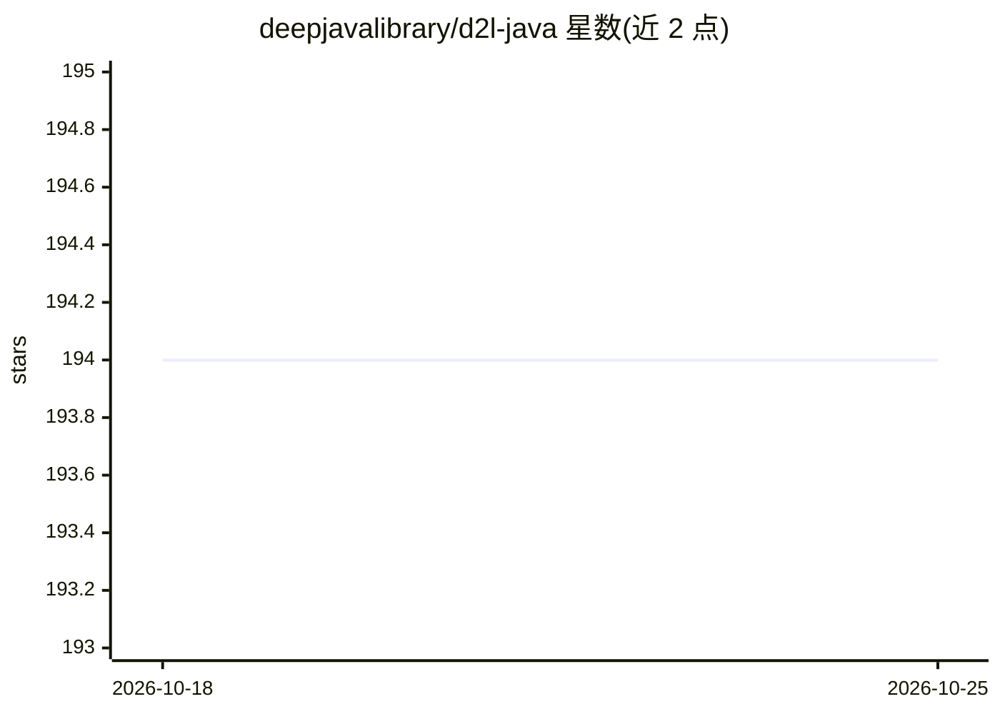

# deepjavalibrary/d2l-java

⭐ 194 · Jupyter Notebook · NOASSERTION · 推送 2026-10-19 · [GitHub](https://github.com/deepjavalibrary/d2l-java) · [官网](https://d2l.djl.ai) · 组织维护

**《动手学深度学习》Java 版教材：基于 DJL 的可运行 Jupyter 笔记本**

将《Dive into Deep Learning》教材改编为 Java 版本，使用 Deep Java Library(DJL)实现，覆盖线性网络、多层感知机、CNN、RNN、注意力机制、优化算法、计算机视觉、NLP 预训练等章节。笔记本可通过 Java Kernel 下载运行，也可在 Binder 或 Colab 在线运行，并编译为网站。项目由 AWS 与 DJL 社区开发维护，未实现的章节不在列表中。

## 筛选速览

| 维度 | 判定 | 备注 |
|---|---|---|
| AI 角色 | `ai-knowledge` | 知识聚合/清单类 |
| 许可风险 | `none` | NOASSERTION |
| 部署形态 | `None` |  |
| 模型依赖 | — | README 未给出锁定关系 |
| 硬件要求 | — | 无带数字的原话,不猜 |
| 安装摩擦 | `low` | 无编译、无系统依赖或容器化 |
| 成熟度 | — | 结构信号不足 |

## 能力要点

- 将原书内容改写为基于 DJL 的 Java 实现
- 笔记本可通过 Binder/Colab 在线运行或本地 Java Kernel 运行
- 覆盖 CNN、RNN、注意力机制、NLP 预训练等 16 个章节
- 由 AWS 与 DJL 社区维护

## 适用场景

- 用 Java 学习深度学习理论与实践
- 在 Colab/Binder 上在线运行教材代码无需本地配置
- 了解 DJL 框架在教学场景中的用法

## 场景标签

`教程课程` · 领域:学习与行业

## 证据(README 行号)

> L5: We have adapted the book to to use Java and the Deep Java Library(DJL).
> L7: All the notebook here can be downloaded and run using Java Kernel. We also compiled the book into a website.

## 星数曲线

2026-10-18 194 → 2026-10-25 194（+0）

---
*卡片 v1 · prompt 1.4 · 生成 2026-10-22 · 置信度 high · 依据 README sha `c117ace57985` · [字段定义](../../DATASET.md)*
