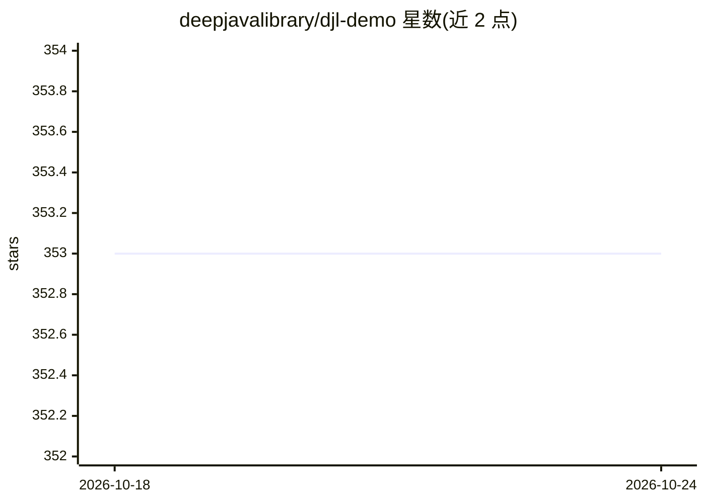

# deepjavalibrary/djl-demo

⭐ 353 · Jupyter Notebook · Apache-2.0 · 推送 2026-04-11 · [GitHub](https://github.com/deepjavalibrary/djl-demo) · [官网](https://demo.djl.ai) · 组织维护

**Deep Java Library (DJL) 官方示例集，覆盖推理/训练/Android/AWS/大数据**

汇集 Deep Java Library (DJL)——一个框架无关的 Java 深度学习 API——的示例源码：推理类（恶意 URL 检测、X 光肺炎检测、摄像头实时目标检测、浏览器运行深度学习）、训练类（鞋类分类训练、训练指标可视化 Web UI）、Android 应用（人脸检测、风格迁移、语义分割、法英翻译、语音识别）、AWS 部署（Lambda、Elastic Beanstalk、Inferentia、Kinesis Video Streams）、大数据集成（Spark、Beam、Flink、Camel）以及多引擎同 JVM、GraalVM 原生编译、Quarkus 部署等示例。面向使用 DJL 进行深度学习开发的 Java 开发者。README 仅列目录说明，未给出具体安装运行命令。

## 筛选速览

| 维度 | 判定 | 备注 |
|---|---|---|
| AI 角色 | `ai-ecosystem` | LLM/agent 周边工具 |
| 许可风险 | `permissive` | Apache-2.0 |
| 部署形态 | `None` |  |
| 模型依赖 | — | README 未给出锁定关系 |
| 硬件要求 | — | 无带数字的原话,不猜 |
| 安装摩擦 | `low` | 无编译、无系统依赖或容器化 |
| 成熟度 | — | 结构信号不足 |

## 能力要点

- 推理与训练示例覆盖 CNN 分类、目标检测、语义分割、语音识别等任务
- 含 Android 深度学习应用示例（人脸检测、风格迁移、法英翻译等）
- AWS 部署示例：Lambda、Elastic Beanstalk、Inferentia、Kinesis Video Streams
- 大数据集成示例：Spark、Apache Beam、Flink、Camel；支持多引擎同 JVM 运行

## 适用场景

- 学习如何在 Java 中用 DJL 做深度学习推理与训练
- 参考 Android 深度学习应用的构建方式
- 了解 DJL 模型在 AWS 或 Spark/Flink 等大数据环境中的部署与集成

## 场景标签

`教程课程` · 领域:学习与行业

## 证据(README 行号)

> L5: The repository contains the source code of the examples for Deep Java Library (DJL) - an
> L6: framework-agnostic Java API for deep learning.

## 星数曲线

2026-10-18 353 → 2026-10-24 353（+0）

---
*卡片 v1 · prompt 1.4 · 生成 2026-10-21 · 置信度 high · 依据 README sha `aff232f01249` · [字段定义](../../DATASET.md)*
