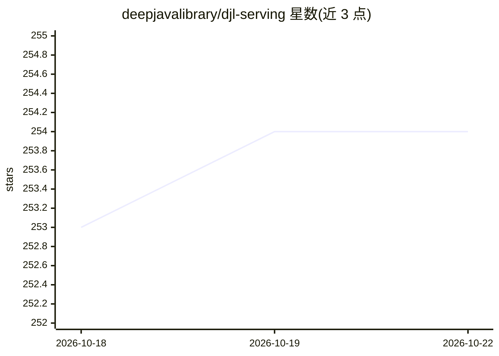

# deepjavalibrary/djl-serving

⭐ 254 · Java · Apache-2.0 · 推送 2026-10-15 · [GitHub](https://github.com/deepjavalibrary/djl-serving) · 组织维护

**通用深度学习模型 HTTP 服务化部署方案（JVM 单机 serving）**

由 DJL 驱动的独立模型服务解决方案：将单个或多个深度学习模型及 workflow 通过 HTTP 端点对外提供推理服务。开箱支持 PyTorch TorchScript、TensorFlow SavedModel、ONNX（CPU）与 Python 脚本模型，安装扩展后可支持 XGBoost、LightGBM、Sentencepiece、fastText 等。运行于单 JVM 多线程推理，提供自动扩缩工作线程、动态批处理、模型版本管理与多引擎同时服务能力，暴露推理 API 与管理 API（默认 8080 端口仅本机访问）。提供 macOS/Ubuntu/Windows 安装包与 Docker 镜像，支持插件扩展。

## 筛选速览

| 维度 | 判定 | 备注 |
|---|---|---|
| AI 角色 | `ai-ecosystem` | LLM/agent 周边工具 |
| 许可风险 | `permissive` | Apache-2.0 |
| 部署形态 | `self-host` | docker 或自建部署 |
| 模型依赖 | — | README 未给出锁定关系 |
| 硬件要求 | — | 无带数字的原话,不猜 |
| 安装摩擦 | `low` | 无编译、无系统依赖或容器化 |
| 成熟度 | — | 结构信号不足 |

## 能力要点

- 开箱支持 PyTorch/TensorFlow/ONNX/Python 脚本模型，扩展后支持 XGBoost 等更多类型
- 自动扩缩工作线程、动态批处理与模型版本管理
- 单 JVM 多线程推理，多引擎模型可同时服务
- 提供 REST 推理 API 与管理 API，支持插件扩展

## 适用场景

- 将训练好的深度学习模型通过 HTTP 端点对外提供推理服务
- 在同一服务中托管多种引擎（PyTorch/TensorFlow/ONNX）的模型
- 通过管理 API 动态添加、移除与扩缩模型

## 场景标签

 · 领域:机器学习基础设施/模型服务

## 证据(README 行号)

> L5: DJL Serving is a high performance universal stand-alone model serving solution powered by DJL.
> L94: DJL Serving uses a RESTful API for both inference and management calls.

## 星数曲线

2026-10-18 253 → 2026-10-22 254（+1）

---
*卡片 v1 · prompt 1.4 · 生成 2026-10-22 · 置信度 high · 依据 README sha `792091fbf80e` · [字段定义](../../DATASET.md)*
