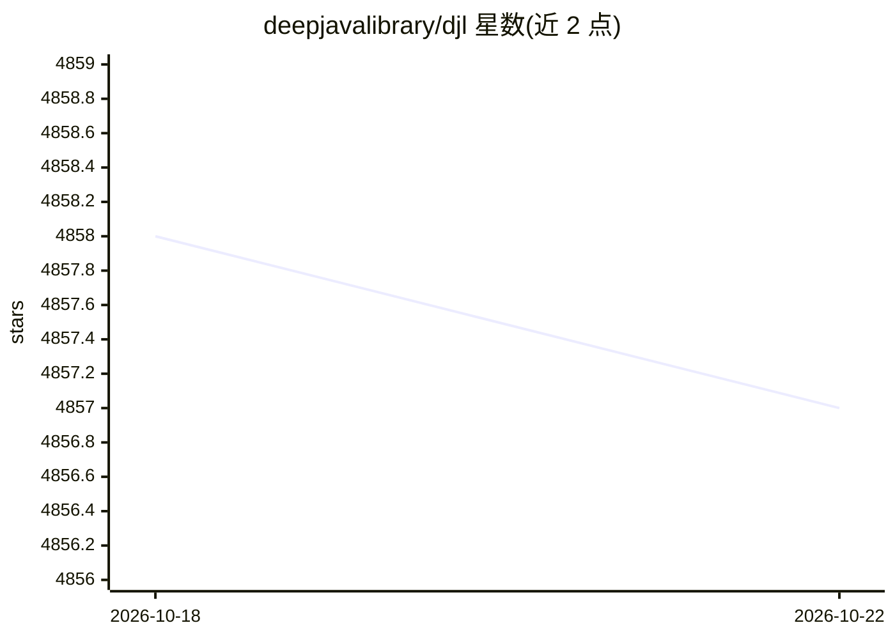

# deepjavalibrary/djl

⭐ 4,857 · Java · Apache-2.0 · 推送 2026-10-20 · [GitHub](https://github.com/deepjavalibrary/djl) · [官网](https://djl.ai) · 组织维护

**面向 Java 开发者的引擎无关深度学习框架**

DJL 是开源的高层、引擎无关的 Java 深度学习框架，以普通 Java 库形式提供原生 Java 开发体验。支持在 IDE 中构建、训练与部署模型并集成到 Java 应用；可随时切换底层引擎，并根据硬件配置自动选择 CPU/GPU。API 设计面向深度学习任务提供引导式接口，附文档、JavaDoc、D2L 书籍 Java 版与演示。源码通过 Gradle 构建，许可证为 Apache-2.0。

## 筛选速览

| 维度 | 判定 | 备注 |
|---|---|---|
| AI 角色 | `ai-ecosystem` | LLM/agent 周边工具 |
| 许可风险 | `permissive` | Apache-2.0 |
| 部署形态 | `None` |  |
| 模型依赖 | — | README 未给出锁定关系 |
| 硬件要求 | — | 无带数字的原话,不猜 |
| 安装摩擦 | `low` | 无编译、无系统依赖或容器化 |
| 成熟度 | — | 结构信号不足 |

## 能力要点

- 引擎无关设计，可在项目任意阶段切换深度学习引擎
- 根据硬件配置自动选择 CPU/GPU
- 在 IDE 中构建、训练、部署模型并集成到 Java 应用

## 适用场景

- Java 开发者以现有技能上手深度学习
- 在 Java 应用中加载预训练模型做推理
- 构建和训练神经网络模型

## 场景标签

`模型训练` `推理引擎` · 领域:训练与推理

## 证据(README 行号)

> L13: Deep Java Library (DJL) is an open-source, high-level, engine-agnostic Java framework for deep learning. DJL is des
> L20: Because DJL is deep learning engine agnostic, you don't have to make a choice

## 星数曲线

2026-10-18 4,858 → 2026-10-22 4,857（-1）

---
*卡片 v1 · prompt 1.4 · 生成 2026-10-20 · 置信度 high · 依据 README sha `0993ce16b353` · [字段定义](../../DATASET.md)*
