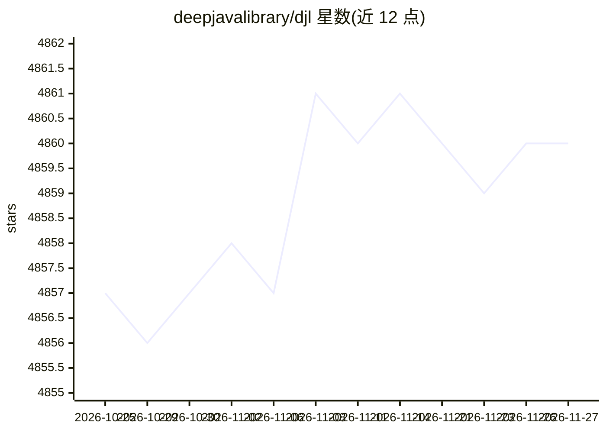

# deepjavalibrary/djl

⭐ 4,860 · Java · Apache-2.0 · 推送 2026-11-25 · [GitHub](https://github.com/deepjavalibrary/djl) · [官网](https://djl.ai) · 组织维护

**面向 Java 开发者的引擎无关深度学习框架**

Deep Java Library 是一个引擎无关的高级 Java 深度学习框架，为 Java 开发者提供原生开发体验，可像普通 Java 库一样使用。用户无需深度学习专家背景，可在熟悉 IDE 中构建、训练和部署模型，并集成到 Java 应用。框架不绑定具体引擎，可随时切换，并依据硬件配置自动选择 CPU/GPU。提供模型加载推理与网络构建训练的 API；源码通过 Gradle 构建，采用 Apache-2.0 许可。

## 筛选速览

| 维度 | 判定 | 备注 |
|---|---|---|
| AI 角色 | `ai-ecosystem` | LLM/agent 周边工具 |
| 许可风险 | `permissive` | Apache-2.0 |
| 部署形态 | `None` |  |
| 模型依赖 | — | README 未给出锁定关系 |
| 硬件要求 | — | 无带数字的原话,不猜 |
| 安装摩擦 | `low` | 无编译、无系统依赖或容器化 |
| 成熟度 | — | 结构信号不足 |

## 能力要点

- 引擎无关设计，可在项目中随时切换深度学习引擎
- 基于硬件配置自动选择 CPU/GPU
- 从模型库加载预训练模型即可运行推理
- 内置 Block 结构构建神经网络进行训练

## 适用场景

- 在 Java 应用中集成深度学习推理
- 用 Java 构建、训练神经网络模型
- 在不锁定引擎的前提下管理深度学习依赖

## 场景标签

`推理引擎` · 领域:训练与推理

## 证据(README 行号)

> L13: Deep Java Library (DJL) is an open-source, high-level, engine-agnostic Java framework for deep learning. DJL is des
> L20: Because DJL is deep learning engine agnostic, you don't have to make a choice

## 星数曲线

2026-10-25 4,857 → 2026-11-27 4,860（+3）

---
*卡片 v1 · prompt 1.4 · 生成 2026-11-22 · 置信度 high · 依据 README sha `c7e6180ebb1f` · [字段定义](../../DATASET.md)*
