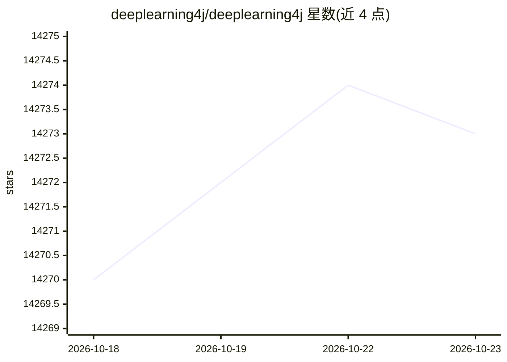

# deeplearning4j/deeplearning4j

⭐ 14,273 · Java · Apache-2.0 · 推送 2026-10-05 · [GitHub](https://github.com/deeplearning4j/deeplearning4j) · [官网](http://deeplearning4j.konduit.ai) · 组织维护

**JVM 平台的深度学习训练与部署工具套件**

Eclipse Deeplearning4J 是面向 JVM 的深度学习项目集合，覆盖从数据加载、预处理到构建与调优各类深度网络的流程。套件包含高层 API（DL4J）、线性代数库 ND4J（基于 C++ 的 LibND4J，提供 CPU/GPU 加速）、自动微分框架 SameDiff、ETL 工具 DataVec 与 Python4J。支持 Keras、TensorFlow、ONNX 模型导入，可在 Apache Spark 上分布式训练。仅支持通过构建工具使用，可从源码构建。由 Konduit K.K. 团队开发。

## 筛选速览

| 维度 | 判定 | 备注 |
|---|---|---|
| AI 角色 | `ai-native` | 本体是模型或模型工具 |
| 许可风险 | `permissive` | Apache-2.0 |
| 部署形态 | `None` |  |
| 模型依赖 | — | README 未给出锁定关系 |
| 硬件要求 | — | 无带数字的原话,不猜 |
| 安装摩擦 | `medium` | 含编译或系统依赖之一 |
| 成熟度 | — | 结构信号不足 |

## 动量与使用信号

- 维护:`active` — 距上次 push 13.2 天,年发版 0,74 位贡献者
- 涨星:近 1 天 **+0**(自 20261016 起算)
- 安装:github 包 `release-assets` 月下载无数据
- 平台:WINDOWS / MACOS / LINUX · 协议:—

## 能力要点

- ND4J 提供 500+ 数学/线性代数/深度学习运算，底层 C++ 支持 CPU（AVX2/512）与 CUDA GPU 加速
- SameDiff 自动微分框架支持导入 TensorFlow .pb 模型
- DL4J 支持 Keras h5 模型导入与 Apache Spark 分布式训练
- 支持 Java、Scala、Kotlin、Clojure 等 JVM 语言

## 适用场景

- 在 Java/Scala 等 JVM 技术栈中训练和部署深度学习模型
- 将 Keras、TensorFlow、ONNX 模型导入 JVM 环境运行
- 在 Spark 集群上做分布式模型训练
- 对机器学习数据做多格式 ETL 处理

## 场景标签

`模型训练` `推理引擎` · 领域:训练与推理

## 证据(README 行号)

> L8: The **Eclipse Deeplearning4J** (DL4J) ecosystem is a set of projects intended to support all the needs of a JVM base
> L14: - **ND4J**: General purpose linear algebra library with over 500 mathematical, linear algebra and deep learning ope
> L84: Deeplearning4J is actively developed by the team at Konduit K.K..

## 星数曲线

2026-10-18 14,270 → 2026-10-23 14,273（+3）

---
*卡片 v1 · prompt 1.4 · 生成 2026-10-18 · 置信度 high · 依据 README sha `ea0e7846d24f` · [字段定义](../../DATASET.md)*
