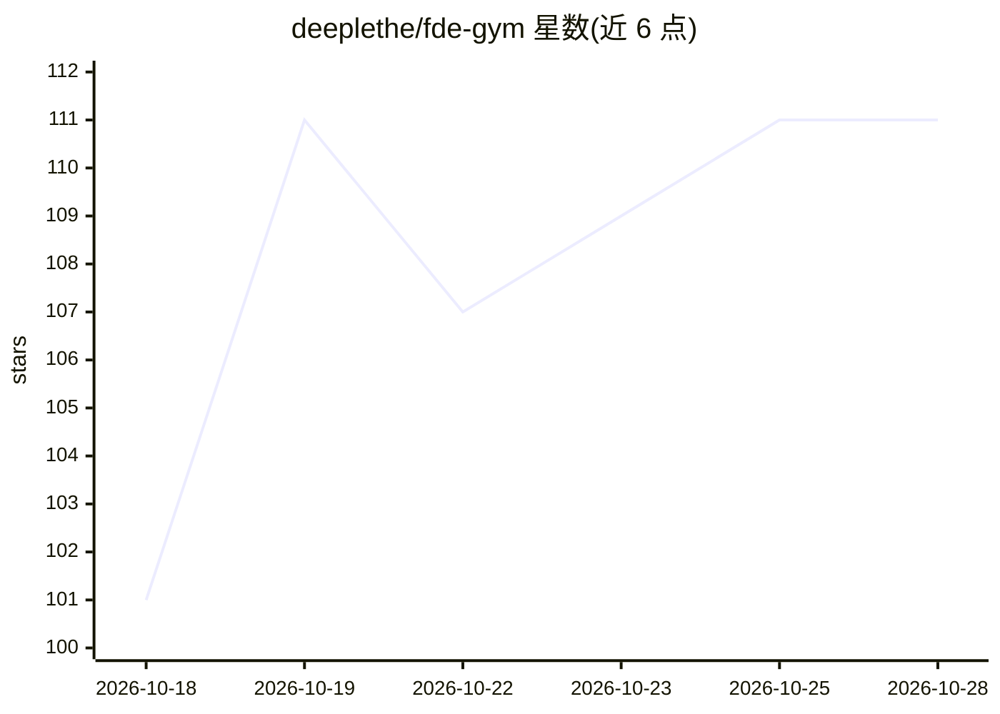

# deeplethe/fde-gym

⭐ 107 · TypeScript · Apache-2.0 · 推送 2026-10-18 · [GitHub](https://github.com/deeplethe/fde-gym) · [官网](https://fde-gym.com/paper) · 个人维护 · 中文 README

**面向前置交付工程师（FDE）的实战评测平台：用 coding agent 完成真实客户交付案例**

自托管在线评测站点，以真实客户交付为题目：每个案例包含运行中的系统、文档、历史与可询问的客户人员，用户在浏览器工作台指挥 coding agent 定位并修复系统，交接后系统在未见过的流量上运行，按客户指标改善程度打 0-100 分（80 分通过，生产事故记 0 分）。提供案例库、提交记录、排行榜、管理后台与可用 CLI/AI agent 操作的 harness。部署需 Docker、Python 3.9+ 与 OpenRouter key（模型扮演客户人员）。

## 筛选速览

| 维度 | 判定 | 备注 |
|---|---|---|
| AI 角色 | `ai-ecosystem` | LLM/agent 周边工具 |
| 许可风险 | `permissive` | Apache-2.0 |
| 部署形态 | `self-host` | docker 或自建部署 |
| 模型依赖 | — | README 未给出锁定关系 |
| 硬件要求 | — | 无带数字的原话,不猜 |
| 安装摩擦 | `low` | 无编译、无系统依赖或容器化 |
| 成熟度 | `idea` | |

## 能力要点

- 案例为真实客户交付：读交接文档、问人、指挥 coding agent 修复运行中的系统
- 评分按客户自身指标在未见流量上的改善程度，0-100 分制
- 自托管：docker compose 启动站点、runner、PostgreSQL 与 S3 兼容对象存储
- harness 仅依赖 Python 标准库，同一案例可由人或 AI agent 从命令行完成

## 适用场景

- 训练 FDE 从模糊客户需求中定位真实问题并负责上线结果
- 团队自建内部评测站点，沉淀真实交付场景为案例
- 用同一案例对比人或 AI agent 的交付表现

## 场景标签

`模型评测` · 领域:评测与运维

## 证据(README 行号)

> L22: (FDEs). Every case on FDE Gym is a real customer delivery: you work it with a coding agent, and your
> L58: |**Online workbench**|Your desk, in the browser: the workspace's files, a terminal, a coding agent that takes your 
> L60: |**Leaderboard**|Members ranked by cases solved, then by score. A case is solved by a run that scores 80 or more ou

## 星数曲线

2026-10-18 101 → 2026-10-28 111（+10）

---
*卡片 v1 · prompt 1.4 · 生成 2026-10-23 · 置信度 high · 依据 README sha `3216bb30675d` · [字段定义](../../DATASET.md)*
