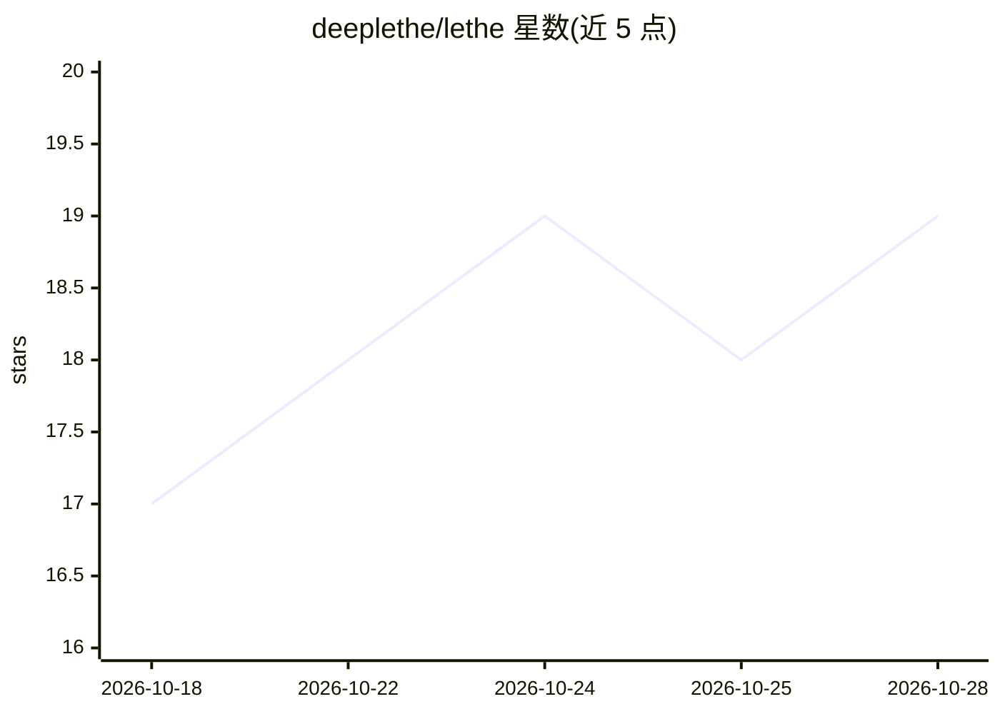

# deeplethe/lethe

⭐ 19 · Python · MIT · 推送 2026-06-16 · [GitHub](https://github.com/deeplethe/lethe) · 个人维护

**面向 AI agent 的本地优先记忆系统：以单一 depth 轴实现记忆与遗忘**

为 AI agent 提供记忆存储与删除能力的 Python 库（PyPI 名 pylethe）：每个事实带一个 depth 数值，pin/supersede/purge 等操作改变深度，实现置顶、下沉与遗忘。存储为单个 SQLite 文件（向量+BM25+FTS，RRF 融合检索），可验证遗忘返回 Ed25519 签名回执并锚定 Merkle 根，支持时间旅行 recall(at=T)。提供库、CLI 与 MCP 十一工具（可接入 Claude Desktop/Cursor），可选 LLM hook 仅用于变更操作，召回热路径零 API 调用。自报 v1.0.0-alpha 状态。

## 筛选速览

| 维度 | 判定 | 备注 |
|---|---|---|
| AI 角色 | `ai-ecosystem` | LLM/agent 周边工具 |
| 许可风险 | `permissive` | MIT |
| 部署形态 | `library` | 以包/库形式分发 |
| 模型依赖 | — | README 未给出锁定关系 |
| 硬件要求 | — | 无带数字的原话,不猜 |
| 安装摩擦 | `low` | 无编译、无系统依赖或容器化 |
| 成熟度 | `idea` | |

## 能力要点

- 单一 depth 数值轴建模记忆状态（pinned/surfaced/sinking/submerged/erased）
- 单 SQLite 文件存储，recall 热路径零 API 调用
- 签名式 purge 返回 Ed25519 签名回执，锚定事件日志 Merkle 根
- MCP 暴露 11 个工具，可接入 Claude Desktop / Claude Code / Cursor

## 适用场景

- 给 agent 接入支持遗忘与替代（supersede）的记忆层
- GDPR 删除场景下生成可验证的加密删除回执
- 通过时间旅行调试 agent 历史记忆状态
- OTP 等短时效信息自动衰减过期

## 场景标签

`Agent 记忆` · 领域:Agent 开发

## 证据(README 行号)

> L150: - **One physical axis: `depth`.** Every state — pinned, surfaced,
> L155: - **Two retrieval primitives.** `recall(query)` is RRF-blended vec +
> L198: **MCP** — eleven tools exposed over stdio (every core operation plus

## 星数曲线

2026-10-18 17 → 2026-10-28 19（+2）

---
*卡片 v1 · prompt 1.4 · 生成 2026-10-28 · 置信度 high · 依据 README sha `09c4b445c696` · [字段定义](../../DATASET.md)*
