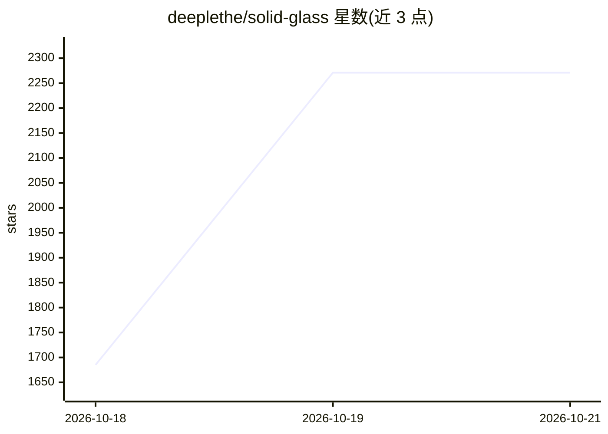

# deeplethe/solid-glass

⭐ 2,271 · TypeScript · MIT · 推送 2026-10-18 · [GitHub](https://github.com/deeplethe/solid-glass) · [官网](https://deeplethe.github.io/solid-glass) · 个人维护

**面向 AI 应用的玻璃质感 shadcn/ui 设计系统**

一个以“实心玻璃”为语言的样式主题与组件集：以单一 CSS 样式表的形式存在，通过 data-slot 与既有类名作用于 shadcn/ui 组件，无需改动组件本身，支持亮/暗双主题。针对 AI 界面提供自有组件（turn-status、composer、tool-steps、reasoning、context-ring 等）与整屏 Blocks（如 agent-workspace）。基于 React 19、Tailwind CSS 4 与 Base UI 组件，通过 npx shadcn add 命令从仓库 registry 安装，另附可本地运行的文档站点（npm run dev）。MIT 许可。

## 筛选速览

| 维度 | 判定 | 备注 |
|---|---|---|
| AI 角色 | `ai-ecosystem` | LLM/agent 周边工具 |
| 许可风险 | `permissive` | MIT |
| 部署形态 | `library` | 以包/库形式分发 |
| 模型依赖 | — | README 未给出锁定关系 |
| 硬件要求 | — | 无带数字的原话,不猜 |
| 安装摩擦 | `low` | 无编译、无系统依赖或容器化 |
| 成熟度 | — | 结构信号不足 |

## 能力要点

- 单一 CSS 样式表按 data-slot 作用于现有 shadcn/ui 组件，组件无需改动
- 面向 agent 界面的自有组件：turn-status、tool-steps、reasoning、context-ring 等
- 整屏 Blocks（agent-workspace）与 Create 页面可视化调节材质参数并导出 CSS
- 亮/暗双主题，定义与 shadcn/ui 同名的颜色变量

## 适用场景

- 给基于 shadcn/ui 的 AI 应用换上统一的玻璃质感主题
- 搭建 agent 工作区界面（会话、线程、后台任务、上下文占用）
- 在 Create 页面调出厚度/色调/圆角等参数并复制对应 CSS

## 场景标签

 · 领域:前端/UI 设计系统

## 证据(README 行号)

> L49: AI applications are built around information that is constantly changing — responses streaming in,
> L101: |`turn-status`, `composer`, `tool-steps`, `diff-view`, `ask-card`, `context-ring`, `task-notice`, `reasoning`|For 

## 星数曲线

2026-10-18 1,685 → 2026-10-21 2,271（+586）

---
*卡片 v1 · prompt 1.4 · 生成 2026-10-21 · 置信度 mid · 依据 README sha `373a6e0292a1` · [字段定义](../../DATASET.md)*
