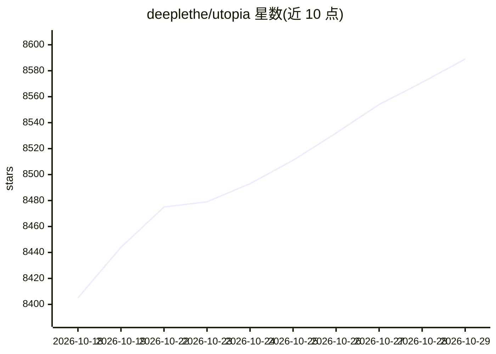

# deeplethe/utopia

⭐ 8,589 · Rust · Apache-2.0 · 推送 2026-10-28 · [GitHub](https://github.com/deeplethe/utopia) · 组织维护 · 中文 README

**自托管企业级双时序知识图谱平台，供 agent 可信决策**

由 DeepLethe 构建的开源自托管企业世界模型：单一 Rust 二进制加 Postgres（pgvector、Tantivy 全文检索），将 PDF/Office/网页/多源同步的文档抽取为遵循本体论的实体与事实，构成双时序知识图谱（记录事实何时为真与系统何时知晓）。提供带引用的流式问答、冲突检测、实体消解、推理派生、决策账本与多用户权限，并通过 MCP 向 Claude Desktop、Cursor 等 agent 暴露只读工具。兼容任意 OpenAI 端点（DeepSeek/Qwen/GLM/Ollama/vLLM），可离线部署；当前为 v0.1，迁移仅向前。

## 筛选速览

| 维度 | 判定 | 备注 |
|---|---|---|
| AI 角色 | `ai-native` | 本体是模型或模型工具 |
| 许可风险 | `permissive` | Apache-2.0 |
| 部署形态 | `self-host` | docker 或自建部署 |
| 模型依赖 | local-ok | 支持本地模型 |
| 硬件要求 | — | 无带数字的原话,不猜 |
| 安装摩擦 | `low` | 无编译、无系统依赖或容器化 |
| 成熟度 | `idea` | |

## 能力要点

- 双时序知识图谱：事实带生效时间与来源，修正以关闭并链接旧版而非覆盖
- 本体驱动的抽取、推理派生与三类冲突检测
- 每个知识库一个 MCP server，向外部 agent 暴露带细粒度权限的只读工具
- 单一 Rust 二进制 + Postgres，Docker 预构建镜像部署，可离线运行

## 适用场景

- 在自有硬件上搭建带完整审计轨迹的企业知识底座
- 让 Claude Desktop / Cursor 等 agent 通过 MCP 查询带时间点的结构化事实
- 回答'某日期时某合同条款/某负责人是谁'这类时点问题

## 场景标签

`知识图谱` `Agent 记忆` `RAG` `文档问答` · 领域:Agent 开发

## 证据(README 行号)

> L19: **The enterprise world model built by DeepLethe.** It is the first open substrate for knowledge engineering that le
> L52: |**Search and chat**|Full-text on Tantivy, vectors on pgvector, fused with RRF. Answers stream with inline citation
> L53: |**Agent harness and agentic RAG**|The whole system can be driven through conversation. The built-in agent searches

## 星数曲线

2026-10-18 8,405 → 2026-10-29 8,589（+184）

---
*卡片 v1 · prompt 1.4 · 生成 2026-10-20 · 置信度 high · 依据 README sha `eb367ff0133a` · [字段定义](../../DATASET.md)*
