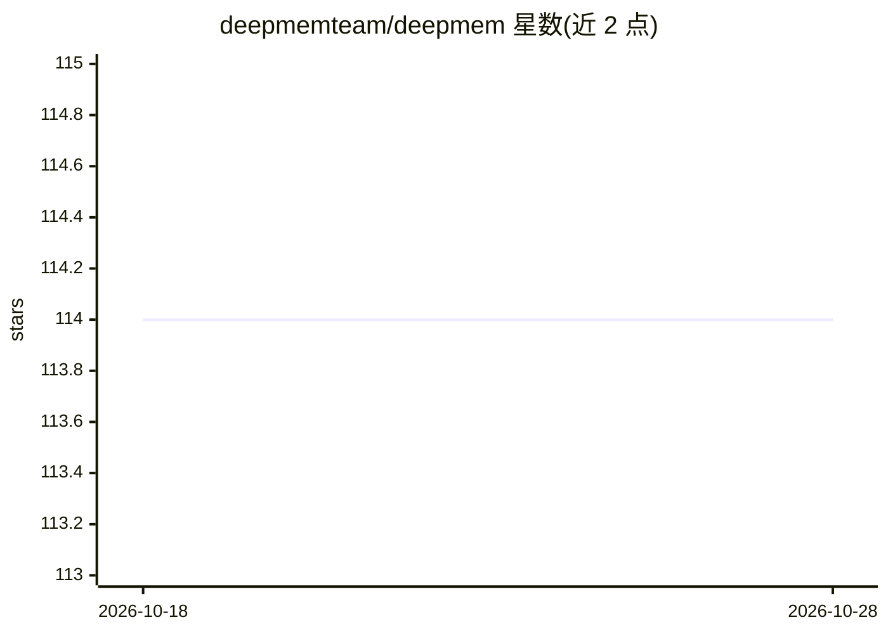

# deepmemteam/deepmem

⭐ 114 · Python · MIT · 推送 2026-08-17 · [GitHub](https://github.com/deepmemteam/deepmem) · [官网](https://deepmem.dev) · 组织维护 · 中文 README

**给 AI agent 开发者的自托管长期记忆层，兼容 Mem0 API**

面向 agent 开发者的记忆服务：FastAPI HTTP API 前置于 Qdrant 向量库，用 LLM 做事实抽取，检索融合向量相似度、BM25、实体加权与时间衰减；提供异步批量蒸馏（宣称减少约 80% LLM 调用）、语义缓存、GDPR 删除与导出导入、内置 MCP 服务器供 Claude Desktop/Cursor 读写记忆。客户端包镜像 Mem0 的 MemoryClient 接口，可一行 import 迁移。LLM 与嵌入层可按环境变量切换多供应商（OpenAI/Anthropic/OpenAI 兼容端点、BGE-M3 本地等）。限制：无图关系（relations 恒为空）、不支持 Mem0 全部行为（如 reset 按 user_id 粒度）。部署方式为 Docker/自建源码或托管云 deepmem.dev。

## 筛选速览

| 维度 | 判定 | 备注 |
|---|---|---|
| AI 角色 | `ai-ecosystem` | LLM/agent 周边工具 |
| 许可风险 | `permissive` | MIT |
| 部署形态 | `self-host` | docker 或自建部署 |
| 模型依赖 | local-ok | 支持本地模型 |
| 硬件要求 | — | 无带数字的原话,不猜 |
| 安装摩擦 | `low` | 无编译、无系统依赖或容器化 |
| 成熟度 | — | 结构信号不足 |

## 能力要点

- 客户端镜像 Mem0 MemoryClient 接口，一行 import 迁移
- 混合检索：向量 + BM25 + 实体加权 + 时间衰减融合打分
- 内置 MCP 服务器（deepmem_write/search/delete 工具）
- LLM/嵌入层多供应商切换（含本地 BGE-M3、OpenAI 兼容端点）

## 适用场景

- 为 AI agent 添加跨会话的长期记忆与偏好持久化
- 让 Claude Desktop / Cursor 通过 MCP 直接读写记忆
- 从 Mem0 迁移到自托管方案，数据留在自己基础设施上

## 场景标签

`Agent 记忆` · 领域:Agent 开发

## 证据(README 行号)

> L39: Turn conversations into searchable long-term memory: a FastAPI HTTP API in
> L132: Agent frameworks keep re-discovering that they need persistent, retrievable
> L242: **MCP server.** `deepmem_write` / `deepmem_search` / `deepmem_delete` tools

## 星数曲线

2026-10-18 114 → 2026-10-28 114（+0）

---
*卡片 v1 · prompt 1.4 · 生成 2026-10-23 · 置信度 high · 依据 README sha `0e92eea366c8` · [字段定义](../../DATASET.md)*
