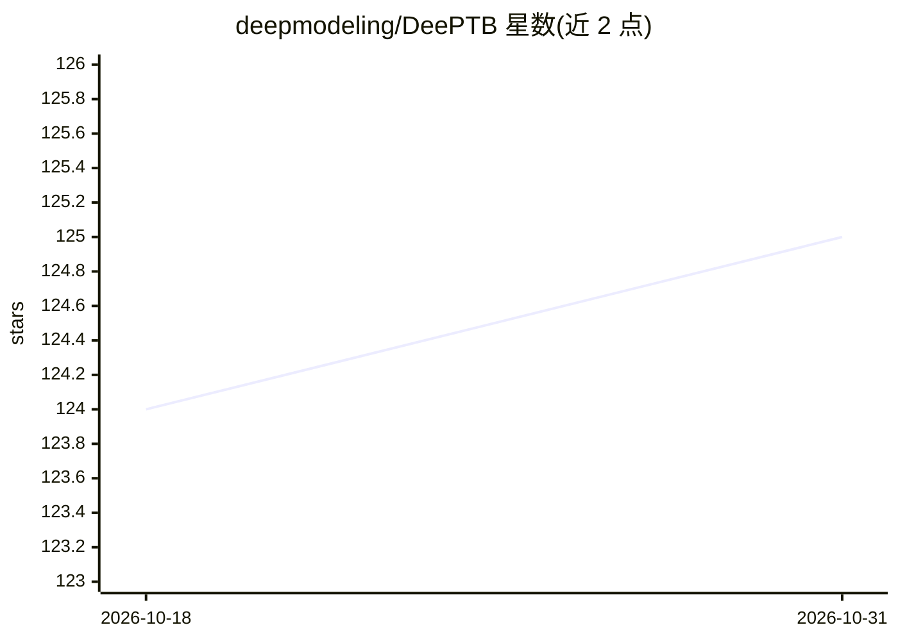

# deepmodeling/DeePTB

⭐ 125 · Python · LGPL-3.0 · 推送 2026-10-12 · [GitHub](https://github.com/deepmodeling/DeePTB) · [官网](https://deepmodeling.github.io/DeePTB/) · 组织维护 · 中文 README

**深度学习预测紧束缚哈密顿量的第一性原理精度模拟包**

面向计算材料与凝聚态物理研究者的 Python 包：用深度学习（神经网络修正的 Slater-Koster 参数化与 E3 等变神经网络）从小体系 DFT 数据训练模型，预测大体系的电子结构，构建 LCAO 基组下的 DFT 哈密顿量/密度与重叠矩阵，支持 SOC、结构扰动与有限温度分子动力学耦合；生成的哈密顿量可接入配套包 DPNEGF 做量子输运。安装推荐 UV + 源码 install.sh（自动创建 .venv 并选定测试过的 Torch/PyG 组合），支持 CPU 与 NVIDIA GPU（CUDA 12.8/13.0 路径），可选 Julia Pardiso 后端仅限 Linux。README 声明处于活跃开发中，建议安装后先跑测试套件。

## 筛选速览

| 维度 | 判定 | 备注 |
|---|---|---|
| AI 角色 | `ai-native` | 本体是模型或模型工具 |
| 许可风险 | `viral` | LGPL-3.0 |
| 部署形态 | `library` | 以包/库形式分发 |
| 模型依赖 | — | README 未给出锁定关系 |
| 硬件要求 | `cpu-ok` | |
| 安装摩擦 | `medium` | 含编译或系统依赖之一 |
| 成熟度 | `idea` | |

## 能力要点

- DeePTB-SK：神经网络修正的局部环境依赖 Slater-Koster 紧束缚模型
- DeePTB-E3：E3 等变 (S)LEM 网络构建 LCAO 基组 DFT 哈密顿量/密度/重叠矩阵
- 训练于小体系，可预测大体系电子结构并耦合分子动力学做有限温度模拟
- 哈密顿量可接入配套 DPNEGF 做 NEGF 量子输运模拟

## 适用场景

- 用小体系 DFT 数据训练后预测大尺度材料的电子结构（DOS、光学性质）
- 构建可直接用于下游物性计算的等变量子算符（哈密顿/重叠/密度矩阵）
- 结合分子动力学与 NEGF 输运（经 DPNEGF）做纳米器件与输运研究

## 场景标签

`科研工具` · 领域:学习与行业

## 证据(README 行号)

> L10: DeePTB is an innovative Python package that uses deep learning to accelerate *ab initio* electronic structure simul
> L14:  1. **DeePTB-SK**: deep learning based local environment dependent Slater-Koster TB.
> L20:  - Construct DFT Hamiltonians/density and overlap matrices under full LCAO basis.

## 星数曲线

2026-10-18 124 → 2026-10-31 125（+1）

---
*卡片 v1 · prompt 1.4 · 生成 2026-10-23 · 置信度 mid · 依据 README sha `429ae5751679` · [字段定义](../../DATASET.md)*
