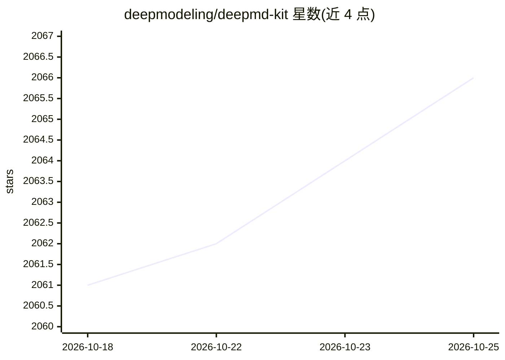

# deepmodeling/deepmd-kit

⭐ 2,068 · Python · LGPL-3.0 · 推送 2026-10-25 · [GitHub](https://github.com/deepmodeling/deepmd-kit) · [官网](https://docs.deepmodeling.com/projects/deepmd/) · 组织维护 · 中文 README

**面向分子动力学的深度势能模型训练与部署工具包**

DeePMD-kit 将量子力学参考数据转化为快速可扩展的原子间相互作用势：提供 DPA4/DPA4C 模型家族，支持从预训练检查点微调或从零训练（单任务/多任务/分布式），可训练能量、力、virial、Hessian、偶极矩、极化率等多种物理量。后端支持 TensorFlow、PyTorch、JAX、Paddle。训练后通过 Python、C/C++、Node.js 接口推理，并接入 LAMMPS、i-PI、ASE、GROMACS、OpenMM 等模拟引擎运行 MPI 并行分子动力学。面向计算化学与材料科学研究者。

## 筛选速览

| 维度 | 判定 | 备注 |
|---|---|---|
| AI 角色 | `ai-native` | 本体是模型或模型工具 |
| 许可风险 | `viral` | LGPL-3.0 |
| 部署形态 | `self-host` | docker 或自建部署 |
| 模型依赖 | — | README 未给出锁定关系 |
| 硬件要求 | — | 无带数字的原话,不猜 |
| 安装摩擦 | `low` | 无编译、无系统依赖或容器化 |
| 成熟度 | — | 结构信号不足 |

## 能力要点

- 预训练 DPA4 模型下载、微调到部署的完整工作流
- 多后端支持：TensorFlow、PyTorch、JAX、Paddle
- 接入 LAMMPS、i-PI、ASE、GROMACS、OpenMM 等模拟引擎
- 支持能量/力之外的性质：virial、Hessian、自旋力、偶极矩、极化率、电子态密度

## 适用场景

- 为我的材料体系微调预训练深度势模型并做分子动力学模拟
- 从量子力学计算数据训练机器学习势并接入 LAMMPS
- 预测偶极矩、极化率等超出常规力场的物理性质

## 场景标签

`微调` `模型训练` · 领域:训练与推理

## 证据(README 行号)

> L27: DeePMD-kit turns quantum-mechanical reference data into fast, scalable
> L44: |🧲|**More than energy and force**|Model virials, Hessians, spin and magnetic forces, dipoles, polarizabilities, ele
> L47: |🔌|**Deploy where science happens**|Use the CLI, Python, C, C++, or Node.js, then connect models to LAMMPS, i-PI, A

## 星数曲线

2026-10-18 2,061 → 2026-10-25 2,066（+5）

---
*卡片 v1 · prompt 1.4 · 生成 2026-10-21 · 置信度 mid · 依据 README sha `39e0d4ecb167` · [字段定义](../../DATASET.md)*
