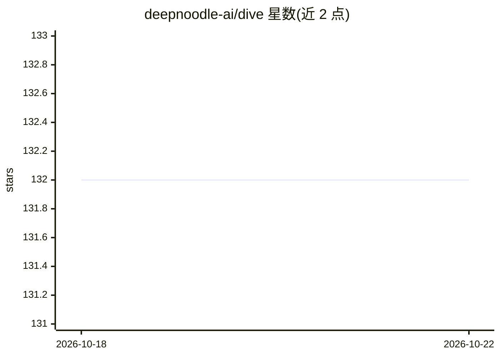

# deepnoodle-ai/dive

⭐ 132 · Go · Apache-2.0 · 推送 2026-10-22 · [GitHub](https://github.com/deepnoodle-ai/dive) · [官网](https://deepnoodle.ai) · 组织维护

**Go 语言的 AI agent 构建库：统一 LLM 接入与工具调用循环**

由 Deep Noodle 开发的 Go 基础库，用于构建 AI agent 与 LLM 应用。提供三部分：8+ LLM 提供商的统一访问（Anthropic/OpenAI/Google/Grok/OpenRouter/Mistral/Ollama，均支持工具调用）、工具调用系统（内置 Read/Write/Edit/Bash 等工具，支持自定义工具与 MCP）、带 hooks 的 agent 循环（生成前后的拦截点）。还提供会话持久化、流式输出、类型化 system reminder、markdown 技能系统。experimental 目录（压缩、子代理、沙箱、CLI 等）无稳定性保证。

## 筛选速览

| 维度 | 判定 | 备注 |
|---|---|---|
| AI 角色 | `ai-ecosystem` | LLM/agent 周边工具 |
| 许可风险 | `permissive` | Apache-2.0 |
| 部署形态 | `None` |  |
| 模型依赖 | local-ok | 支持本地模型 |
| 硬件要求 | — | 无带数字的原话,不猜 |
| 安装摩擦 | `low` | 无编译、无系统依赖或容器化 |
| 成熟度 | — | 结构信号不足 |

## 能力要点

- 8+ LLM 提供商统一接口，均支持工具调用
- 内置 Read/Write/Edit/Grep/Bash 等工具与 Claude Code 对齐的工具形态
- PreGeneration/PreToolUse/PostToolUse 等 8 类 hooks 的 agent 循环
- markdown 技能系统与类型化 system reminder

## 适用场景

- 在 Go 后端服务中加入 agent 能力
- 构建 agentic CLI 工具
- 在 workflow 编排器中运行 agent
- 需要自定义工具与权限控制的 agent 应用

## 场景标签

`Agent 框架` · 领域:Agent 开发

## 证据(README 行号)

> L7: Dive is a foundational Go library for building AI agents and LLM-powered applications.
> L9: Dive gives you three main things: consistent access to 8+ LLM providers, a
> L82: Anthropic, OpenAI, Google, Grok, OpenRouter, Mistral, Ollama. All support

## 星数曲线

2026-10-18 132 → 2026-10-22 132（+0）

---
*卡片 v1 · prompt 1.4 · 生成 2026-10-22 · 置信度 high · 依据 README sha `e38dce412b65` · [字段定义](../../DATASET.md)*
