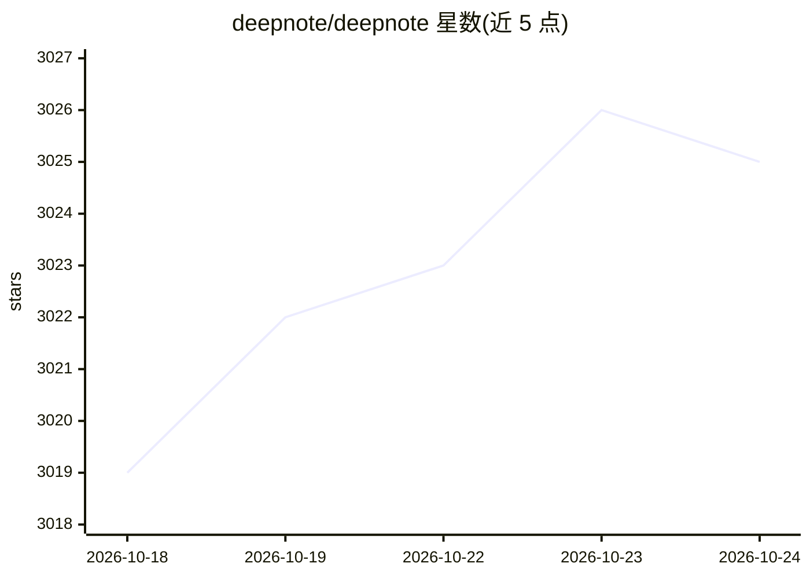

# deepnote/deepnote

⭐ 3,025 · TypeScript · Apache-2.0 · 推送 2026-10-23 · [GitHub](https://github.com/deepnote/deepnote) · [官网](https://deepnote.com/?utm_source=github&utm_medium=github&utm_campaign=github&utm_content=readme_main) · 组织维护

**Jupyter 的替代性数据笔记本：AI 时代的数据分析环境**

Deepnote 定位为 Jupyter 的 drop-in 替代品，使用向后兼容的 Deepnote 内核，新增 AI agent、新块类型（SQL/输入/图表等）与原生数据集成。本仓库收录支撑其笔记本与运行时的可复用组件：@deepnote/blocks 块类型定义与 Python 代码生成、@deepnote/convert 在 .deepnote 与 ipynb/Quarto/Marimo 等格式间双向转换的 CLI 与 API，以及 .deepnote YAML 文件格式规范。本地经 VS Code/Cursor/Windsurf 扩展运行，团队协作与云端算力需升级至 Deepnote Cloud。

## 筛选速览

| 维度 | 判定 | 备注 |
|---|---|---|
| AI 角色 | `ai-enhanced` | 去掉 AI 部分产品仍成立 |
| 许可风险 | `permissive` | Apache-2.0 |
| 部署形态 | `library` | 以包/库形式分发 |
| 模型依赖 | — | README 未给出锁定关系 |
| 硬件要求 | — | 无带数字的原话,不猜 |
| 安装摩擦 | `low` | 无编译、无系统依赖或容器化 |
| 成熟度 | — | 结构信号不足 |

## 能力要点

- .deepnote YAML 人类可读格式替代 .ipynb 的 JSON，diff 友好
- 块式架构：SQL、输入、可视化等块类型，经 @deepnote/blocks 定义校验
- 响应式执行：输入或数据变化时自动重跑依赖块
- @deepnote/convert 支持 ipynb/Quarto/Percent/Marimo 双向转换，保留平台元数据

## 适用场景

- 把现有 Jupyter 笔记本转换为 .deepnote 格式并在 VS Code 中编辑运行
- 用 SQL/输入/图表等多种块组织数据分析项目
- 在版本控制中维护结构清晰、diff 干净的笔记本

## 场景标签

`数据分析` · 领域:效率与自动化

## 证据(README 行号)

> L22: Deepnote is a drop-in replacement for Jupyter. It uses the Deepnote kernel, which is more powerful but still backwa
> L50: |**AI features**|Native AI agent and AI code completion|Third-party extensions|

## 星数曲线

2026-10-18 3,019 → 2026-10-24 3,025（+6）

---
*卡片 v1 · prompt 1.4 · 生成 2026-10-20 · 置信度 high · 依据 README sha `78e2bf958cf7` · [字段定义](../../DATASET.md)*
