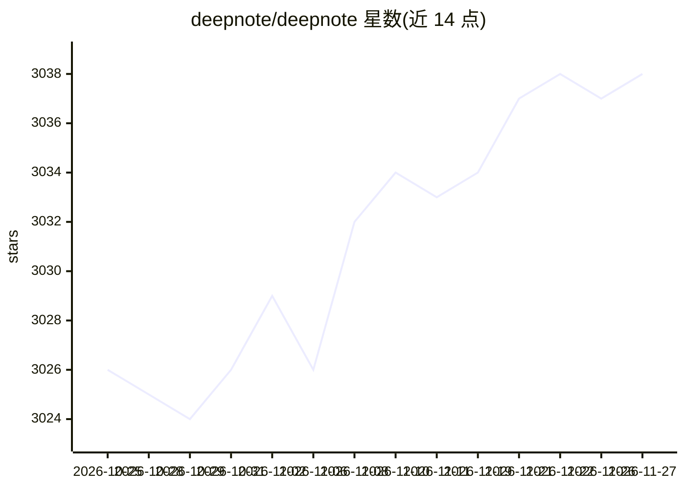

# deepnote/deepnote

⭐ 3,038 · TypeScript · Apache-2.0 · 推送 2026-11-26 · [GitHub](https://github.com/deepnote/deepnote) · [官网](https://deepnote.com/?utm_source=github&utm_medium=github&utm_campaign=github&utm_content=readme_main) · 组织维护

**面向数据专业人员的 AI 时代开源数据笔记本，替代 Jupyter**

Deepnote 开源版提供 .deepnote 笔记本格式（YAML 代替 .ipynb JSON）、块式架构（SQL/输入/图表等块）、响应式执行（输入变化自动重跑依赖块），基于 Jupyter 内核保持兼容。提供 VS Code/Cursor/Windsurf 扩展、@deepnote/convert 双向转换 CLI（支持 Quarto/Percent/Marimo/Colab/SageMaker/Kaggle/Azure ML 导入导出）以及供 Claude Code、Codex、Gemini CLI 等 agent 使用的 CLI 技能。本地免费使用；团队协作、云端算力与 AI agent 需 Deepnote Cloud。教育用户可免费使用云版。

## 筛选速览

| 维度 | 判定 | 备注 |
|---|---|---|
| AI 角色 | `ai-enhanced` | 去掉 AI 部分产品仍成立 |
| 许可风险 | `permissive` | Apache-2.0 |
| 部署形态 | `library` | 以包/库形式分发 |
| 模型依赖 | — | README 未给出锁定关系 |
| 硬件要求 | — | 无带数字的原话,不猜 |
| 安装摩擦 | `low` | 无编译、无系统依赖或容器化 |
| 成熟度 | — | 结构信号不足 |

## 能力要点

- .deepnote YAML 格式：人类可读、便于版本控制，快照分离输出与代码并用 contentHash 记录代码溯源
- 块式架构：代码/SQL/输入/图表等块，通过开源 @deepnote/blocks 包定义
- 响应式执行：输入或数据变化时自动重跑依赖块
- @deepnote/convert 支持与 Jupyter/Quarto/Marimo 等格式双向转换并保留元数据

## 适用场景

- 在 VS Code/Cursor/Windsurf 中本地编写与运行数据笔记本
- 让 AI 编码 agent 直接读写 .deepnote 文件并 lint/run
- 从 Colab/SageMaker/Kaggle 导入 .ipynb 并无损回导
- 教学与科研中协作编写数据笔记本（云版教育免费）

## 场景标签

`数据分析` · 领域:效率与自动化

## 证据(README 行号)

> L22: Deepnote is a drop-in replacement for Jupyter. It uses the Deepnote kernel, which is more powerful but still backwa
> L43: Claude Code, Codex, Cursor, Gemini CLI and other coding agents can work on `.deepnote` files directly in your repos

## 星数曲线

2026-10-25 3,026 → 2026-11-27 3,038（+12）

---
*卡片 v1 · prompt 1.4 · 生成 2026-11-26 · 置信度 high · 依据 README sha `e3a94b0c4098` · [字段定义](../../DATASET.md)*
