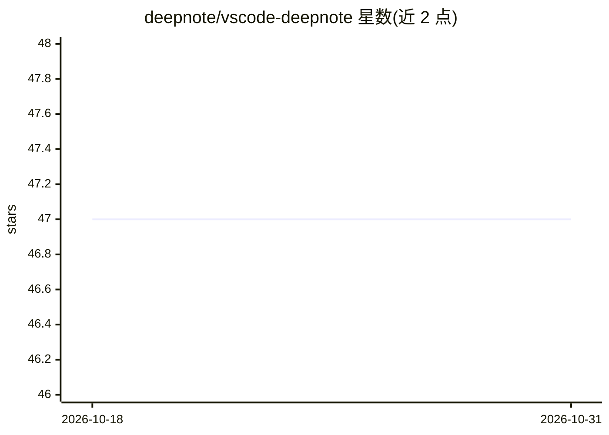

# deepnote/vscode-deepnote

⭐ 47 · TypeScript · NOASSERTION · 推送 2026-10-30 · [GitHub](https://github.com/deepnote/vscode-deepnote) · [官网](https://marketplace.visualstudio.com/items?itemName=Deepnote.vscode-deepnote) · 组织维护

**在 VS Code 等编辑器中运行 Deepnote AI 笔记本的扩展**

由 Deepnote 维护的 VS Code/Cursor/Windsurf/Antigravity 扩展，将 Deepnote 笔记本能力带入编辑器：支持 Python、Markdown、可视化、表格等富块类型，内置 SQL 块与原生数据库连接（Snowflake、BigQuery、Postgres 等 60+ 来源，凭据存于 VS Code 加密 SecretStorage），提供 Init notebooks 自动执行设置代码、自动生成 requirements.txt、兼容 .ipynb 的 Deepnote kernel、快照模式与 Deepnote Cloud 协同。要求 VS Code 1.95.0+ 与 Python 3.10+，经扩展市场安装。

## 筛选速览

| 维度 | 判定 | 备注 |
|---|---|---|
| AI 角色 | `ai-enhanced` | 去掉 AI 部分产品仍成立 |
| 许可风险 | `none` | NOASSERTION |
| 部署形态 | `None` |  |
| 模型依赖 | — | README 未给出锁定关系 |
| 硬件要求 | — | 无带数字的原话,不猜 |
| 安装摩擦 | `low` | 无编译、无系统依赖或容器化 |
| 成熟度 | — | 结构信号不足 |

## 能力要点

- SQL 块开箱即用，支持 60+ 数据库来源原生连接
- 自动生成 requirements.txt 与 Init notebooks 预执行
- 兼容 .ipynb 的 Deepnote kernel
- 快照模式将执行输出与源码分离，便于 Git 协作

## 适用场景

- 在熟悉的编辑器中直接使用 Deepnote 笔记本做数据工作
- 在笔记本内直接查询 PostgreSQL/BigQuery 等数据库
- 本地与 Deepnote Cloud 之间切换并与团队实时协同

## 场景标签

`数据分析` · 领域:效率与自动化

## 证据(README 行号)

> L11: A powerful Visual Studio Code, Cursor, Windsurf, and Antigravity extension that brings Deepnote notebook capabiliti
> L9: # Deepnote in VS Code, Cursor, Windsurf, and Antigravity

## 星数曲线

2026-10-18 47 → 2026-10-31 47（+0）

---
*卡片 v1 · prompt 1.4 · 生成 2026-10-25 · 置信度 high · 依据 README sha `a16d87b5c89a` · [字段定义](../../DATASET.md)*
