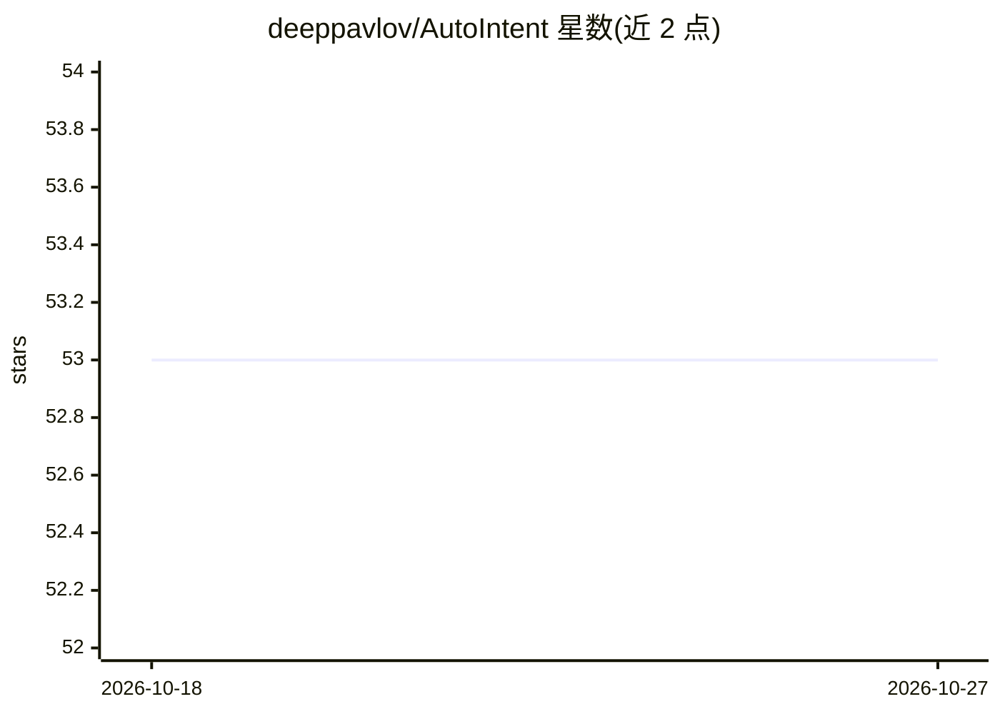

# deeppavlov/AutoIntent

⭐ 53 · Python · Apache-2.0 · 推送 2026-09-18 · [GitHub](https://github.com/deeppavlov/AutoIntent) · [官网](https://deeppavlov.github.io/AutoIntent/) · 组织维护

**意图分类的 AutoML 库：自动配置文本分类流水线**

DeepPavlov 团队维护的开源工具，面向任务型对话系统中的意图检测：用户上传标注数据集，通过 AutoML 方式自动配置文本分类流水线，也可用 sklearn 风格的 fit-predict 接口手动调用方法库；内置 preset（如 classic-light）。以 pip 安装的 Python 库形式提供。项目处于开发阶段，README 声明存在 bug 与破坏性变更；作者发布 EMNLP 2025 论文可供引用。

## 筛选速览

| 维度 | 判定 | 备注 |
|---|---|---|
| AI 角色 | `ai-native` | 本体是模型或模型工具 |
| 许可风险 | `permissive` | Apache-2.0 |
| 部署形态 | `library` | 以包/库形式分发 |
| 模型依赖 | — | README 未给出锁定关系 |
| 硬件要求 | — | 无带数字的原话,不猜 |
| 安装摩擦 | `low` | 无编译、无系统依赖或容器化 |
| 成熟度 | `idea` | |

## 能力要点

- AutoML 方式自动配置意图分类流水线，仅需上传标注数据
- 提供 sklearn 风格 fit-predict 接口的方法库
- 内置 classic-light 等 preset 配置
- 发布 EMNLP 2025 论文

## 适用场景

- 为任务型对话系统构建意图分类器
- 仅有标注数据时自动获得分类流水线配置
- 以库形式集成到现有 NLP 工作流

## 场景标签

 · 领域:NLP/对话系统

## 证据(README 行号)

> L19: **AutoIntent** is an open source tool for automatic configuration of a text classification pipeline for intent pred
> L21: The task of intent detection is one of the main subtasks in creating task-oriented dialogue systems, along with scr

## 星数曲线

2026-10-18 53 → 2026-10-27 53（+0）

---
*卡片 v1 · prompt 1.4 · 生成 2026-10-24 · 置信度 high · 依据 README sha `1ff939d49b50` · [字段定义](../../DATASET.md)*
