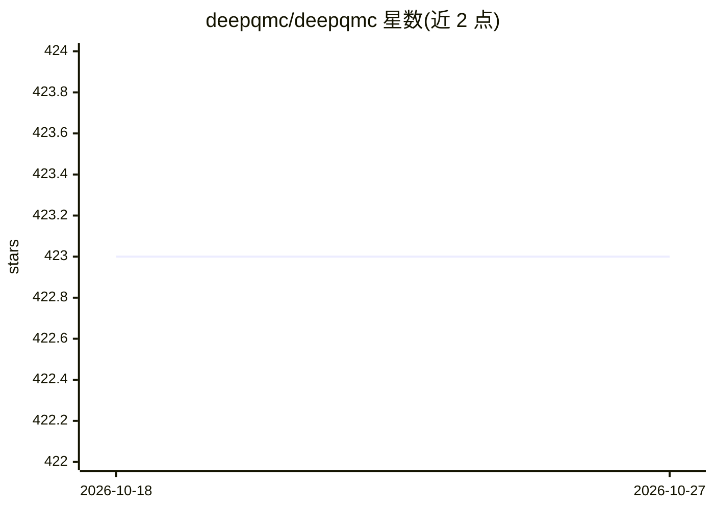

# deepqmc/deepqmc

⭐ 423 · Python · MIT · 推送 2026-10-07 · [GitHub](https://github.com/deepqmc/deepqmc) · 组织维护

**深度学习变分量子蒙特卡罗软件套件：求解分子电子基态与激发态**

基于 JAX 与 Haiku 的开源软件套件，用深度神经网络试探波函数对分子哈密顿量做变分蒙特卡罗模拟，计算电子基态与激发态（惩罚法），支持赝势、固定自旋分区及几何可迁移优化（单一 ansatz 跨多分子构型训练）。内置可配置的通用神经波函数 ansatz，提供 Psiformer、PauliNet、FermiNet、DeepErwin、LapNet、TransPsiformer 等变体的配置文件；通过 Hydra CLI 配置，pip 安装，GPU 运行需自行升级 JAX 的 CUDA 版本。面向量子化学计算研究者，附实现论文与教程文档。

## 筛选速览

| 维度 | 判定 | 备注 |
|---|---|---|
| AI 角色 | `ai-native` | 本体是模型或模型工具 |
| 许可风险 | `permissive` | MIT |
| 部署形态 | `library` | 以包/库形式分发 |
| 模型依赖 | — | README 未给出锁定关系 |
| 硬件要求 | — | 无带数字的原话,不猜 |
| 安装摩擦 | `medium` | 含编译或系统依赖之一 |
| 成熟度 | — | 结构信号不足 |

## 能力要点

- 深度神经网络试探波函数的变分蒙特卡罗模拟
- 惩罚法激发态优化与自旋分区 targeting
- 几何可迁移：单一 ansatz 跨分子构型训练
- 内置 Psiformer/PauliNet/FermiNet/DeepErwin/LapNet 等变体配置

## 适用场景

- 计算分子电子基态能量
- 优化电子激发态（含激发态势能面）
- 跨分子构型训练可迁移波函数并做几何优化

## 场景标签

 · 领域:量子化学/科学计算

## 证据(README 行号)

> L14: DeepQMC is an open-source software suite for variational optimization of deep-learning molecular wave functions. It
> L16: The program solves the molecular Hamiltonian, allowing the use of effective core potentials. Excited states are obt

## 星数曲线

2026-10-18 423 → 2026-10-27 423（+0）

---
*卡片 v1 · prompt 1.4 · 生成 2026-10-21 · 置信度 high · 依据 README sha `431309e828aa` · [字段定义](../../DATASET.md)*
