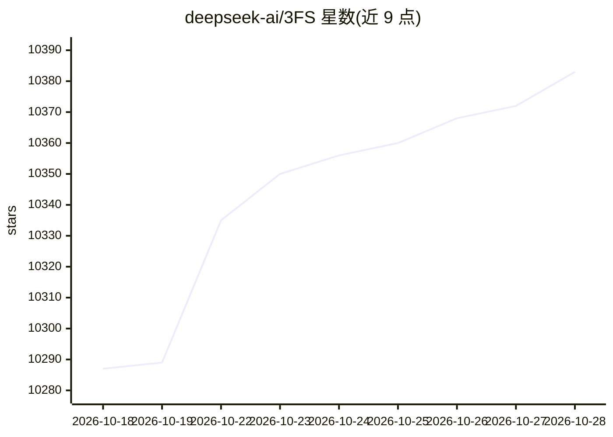

# deepseek-ai/3FS

⭐ 10,392 · C++ · MIT · 推送 2026-05-07 · [GitHub](https://github.com/deepseek-ai/3FS) · 组织维护 · 中文 README

**面向 AI 训练/推理工作负载的高性能分布式文件系统**

由 DeepSeek 开源的高性能分布式文件系统，利用现代 SSD 与 RDMA 网络为分布式应用提供共享存储层。采用分解式架构聚合数千 SSD 与数百存储节点的吞吐，以 CRAQ 链式复制实现强一致性，元数据服务依托事务型 KV 存储（如 FoundationDB）。支持数据准备、随机访问 Dataloader、高吞吐并行 checkpoint 及替代 DRAM 缓存的 KVCache。需从源码编译部署，依赖 libfuse、FoundationDB 与 Rust 工具链，并提供 Docker 构建镜像。

## 筛选速览

| 维度 | 判定 | 备注 |
|---|---|---|
| AI 角色 | `ai-ecosystem` | LLM/agent 周边工具 |
| 许可风险 | `permissive` | MIT |
| 部署形态 | `self-host` | docker 或自建部署 |
| 模型依赖 | — | README 未给出锁定关系 |
| 硬件要求 | — | 无带数字的原话,不猜 |
| 安装摩擦 | `low` | 无编译、无系统依赖或容器化 |
| 成熟度 | — | 结构信号不足 |

## 能力要点

- CRAQ 链式复制实现强一致性
- 180 节点集群压测聚合读吞吐约 6.6 TiB/s
- KVCache 提供高吞吐、大容量的推理缓存方案
- 提供 fio for USRBIO 基准测试引擎与 GraySort 评测结果（3.66 TiB/min）

## 适用场景

- 大规模训练中随机访问数据集，免预取与打乱
- 高吞吐并行保存训练 checkpoint
- 以 SSD 缓存替代 DRAM 方案存放 LLM 推理 KVCache

## 场景标签

`MLOps` · 领域:训练与推理

## 证据(README 行号)

> L6: The Fire-Flyer File System (3FS) is a high-performance distributed file system designed to address the challenges of
> L16:  - **Checkpointing** Supports high-throughput parallel checkpointing for large-scale training.
> L17:  - **KVCache for Inference** Provides a cost-effective alternative to DRAM-based caching, offering high throughput 

## 星数曲线

2026-10-18 10,287 → 2026-10-28 10,383（+96）

---
*卡片 v1 · prompt 1.4 · 生成 2026-10-20 · 置信度 high · 依据 README sha `c154512305e9` · [字段定义](../../DATASET.md)*
