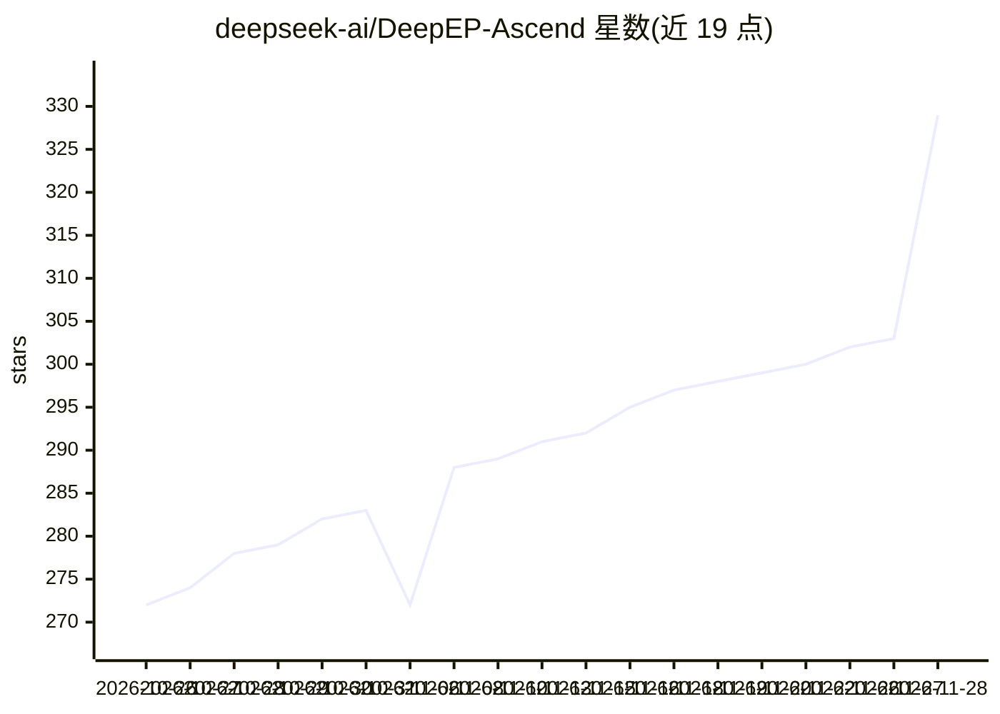

# deepseek-ai/DeepEP-Ascend

⭐ 329 · C++ · 推送 2026-11-27 · [GitHub](https://github.com/deepseek-ai/DeepEP-Ascend) · 组织维护 · 中文 README

**面向昇腾 NPU 的 MoE 训练推理通信库**

面向华为昇腾 NPU 的机器学习训练与推理通信库，提供 MoE dispatch/combine 的专家并行 all-to-all 通信，支持 FP8 dispatch、延迟 epilogue，并提供 PP、CP/DP Bucket 集合通信与 Engram 远端内存访问等原语（部分开发中）。公开 buffer API 与 NVIDIA 版 DeepEP 对齐，内核由 DeepJIT 运行时编译。面向在昇腾集群上做 MoE 模型并行训练与推理的工程师；需 Ascend 950 硬件、CANN 工具链与 torch_npu 环境。

## 筛选速览

| 维度 | 判定 | 备注 |
|---|---|---|
| AI 角色 | `ai-ecosystem` | LLM/agent 周边工具 |
| 许可风险 | `none` | — |
| 部署形态 | `None` |  |
| 模型依赖 | — | README 未给出锁定关系 |
| 硬件要求 | — | 无带数字的原话,不猜 |
| 安装摩擦 | `medium` | 含编译或系统依赖之一 |
| 成熟度 | `idea` | |

## 能力要点

- MoE 专家并行 EP all-to-all：FP8 dispatch、BF16 combine、延迟 epilogue 与专家负载均衡
- EPBuffer/PPBuffer/EngramBuffer/BucketBuffer 等 buffer 接口，与 NVIDIA 版 DeepEP API 对齐
- Ascend C 内核经 DeepJIT 在运行时编译，支持缓存与调试环境变量
- 提供训练/推理共用的 dispatch、combine 与 backward API 及完整测试示例

## 适用场景

- 在昇腾 NPU 集群上运行 MoE 模型的专家并行训练
- 为昇腾上的推理 prefill/decoding 提供高带宽 dispatch/combine 通信
- 为流水线并行、上下文并行负载搭建集合通信原语

## 场景标签

`模型训练` `推理引擎` · 领域:训练与推理

## 证据(README 行号)

> L3: **（中文介绍）**DeepEP-Ascend 是面向华为昇腾 NPU 的高性能机器学习训练与推理通信库，提供 MoE dispatch/combine 的专家并行（EP）all-to-all，支持 FP8 dispatch 和延迟
> L30: - CANN with Ascend C, the Bisheng compiler, HCCL headers, and HCOMM headers and libraries.

## 星数曲线

2026-10-26 272 → 2026-11-28 329（+57）

---
*卡片 v1 · prompt 1.4 · 生成 2026-11-28 · 置信度 high · 依据 README sha `cd737fb55186` · [字段定义](../../DATASET.md)*
