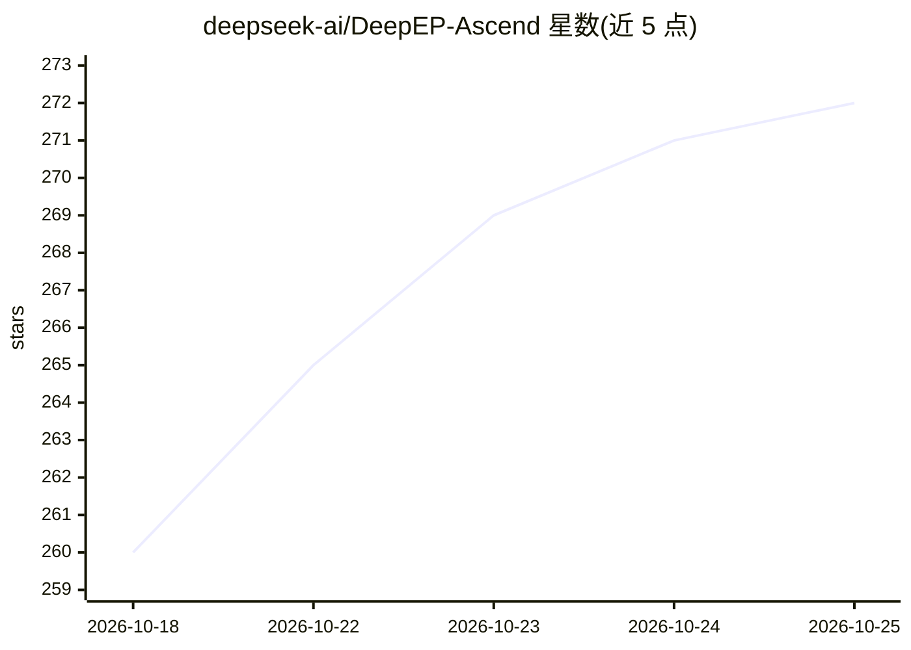

# deepseek-ai/DeepEP-Ascend

⭐ 272 · C++ · 推送 2026-09-30 · [GitHub](https://github.com/deepseek-ai/DeepEP-Ascend) · 组织维护 · 中文 README

**面向华为昇腾 NPU 的 MoE 专家并行通信库**

DeepSeek 发布的面向昇腾 NPU 的机器学习训练/推理通信库：提供 MoE dispatch/combine 的专家并行（EP）all-to-all 操作（含 FP8 dispatch 与延迟 epilogue），以及流水线并行（PP）、CP/DP Bucket 集合通信、Engram 远端内存访问等原语（部分开发中）。公开 buffer API 与 NVIDIA 版 DeepEP 对齐；Ascend C 内核经 DeepJIT 运行时编译。需 Ascend 950、CANN、Bisheng 编译器、torch_npu 环境，从源码克隆构建。

## 筛选速览

| 维度 | 判定 | 备注 |
|---|---|---|
| AI 角色 | `ai-ecosystem` | LLM/agent 周边工具 |
| 许可风险 | `none` | — |
| 部署形态 | `None` |  |
| 模型依赖 | — | README 未给出锁定关系 |
| 硬件要求 | — | 无带数字的原话,不猜 |
| 安装摩擦 | `medium` | 含编译或系统依赖之一 |
| 成熟度 | `idea` | |

## 能力要点

- MoE 专家并行 dispatch/combine，含 FP8 dispatch 与延迟 epilogue
- PP/CP-DP Bucket 集合通信与 Engram 远端内存访问（开发中）
- 公开 buffer API 与 NVIDIA 版 DeepEP 对齐
- Ascend C 内核经 DeepJIT 在运行时编译

## 适用场景

- 在昇腾 NPU 集群上运行 MoE 模型的专家并行训练与推理
- 为基于 torch_npu 的分布式训练提供 all-to-all 通信原语
- 复现/参考 EP 通信带宽基准测试

## 场景标签

 · 领域:分布式机器学习基础设施

## 证据(README 行号)

> L3: **（中文介绍）**DeepEP-Ascend 是面向华为昇腾 NPU 的高性能机器学习训练与推理通信库，提供 MoE dispatch/combine 的专家并行（EP）all-to-all 操作，支持 FP8 dispatch 
> L5: **(English introduction)** DeepEP-Ascend is a high-performance communication library for machine learning training a

## 星数曲线

2026-10-18 260 → 2026-10-25 272（+12）

---
*卡片 v1 · prompt 1.4 · 生成 2026-10-22 · 置信度 high · 依据 README sha `25a2d5afb067` · [字段定义](../../DATASET.md)*
