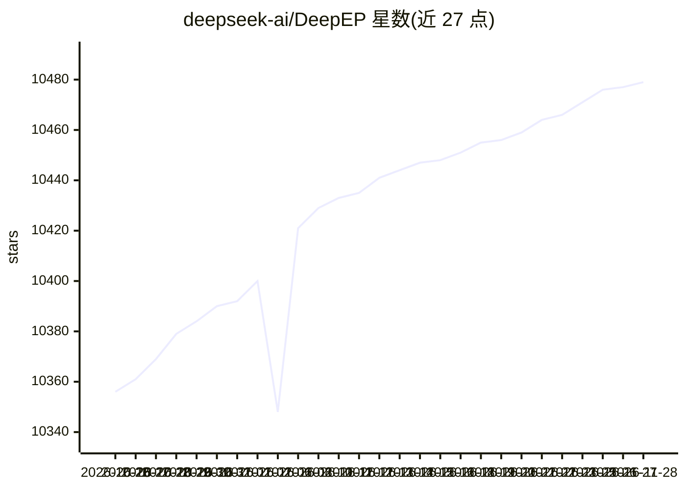

# deepseek-ai/DeepEP

⭐ 10,479 · Cuda · MIT · 推送 2026-11-27 · [GitHub](https://github.com/deepseek-ai/DeepEP) · 组织维护 · 中文 README

**面向 MoE 训练与推理的专家并行 GPU 通信库**

DeepEP 提供 MoE 模型专家并行（EP）的高吞吐、低延迟 all-to-all GPU 通信内核，覆盖 dispatch/combine（含 FP8）、冗余专家的 NVLink 权重与梯度交换，并提供 PP/CP/DP 与远程内存访问的实验性原语。通信内核经 DeepJIT 在运行时编译，安装期仅构建宿主 C++ 扩展，故安装无需可见 GPU。面向构建大规模 MoE 训练/推理系统的工程团队，要求 Linux、Hopper 及以上 GPU、NVLink 与 RDMA 网络。

## 筛选速览

| 维度 | 判定 | 备注 |
|---|---|---|
| AI 角色 | `ai-ecosystem` | LLM/agent 周边工具 |
| 许可风险 | `permissive` | MIT |
| 部署形态 | `library` | 以包/库形式分发 |
| 模型依赖 | — | README 未给出锁定关系 |
| 硬件要求 | — | 无带数字的原话,不猜 |
| 安装摩擦 | `medium` | 含编译或系统依赖之一 |
| 成熟度 | — | 结构信号不足 |

## 能力要点

- 统一 EPBuffer 接口提供高吞吐与低延迟 EP dispatch/combine，含 FP8 dispatch
- DeepJIT 运行时编译通信内核，安装无需可见 GPU 或 TORCH_CUDA_ARCH_LIST
- 支持冗余专家的 NVLink 权重预取与 FP32 梯度归约
- 另有 Ascend 950 版本（DeepEP-Ascend），API 相同

## 适用场景

- 为大规模 MoE 模型训练搭建专家并行通信层
- 在推理 prefill 与解码中复用同一套 dispatch/combine API
- 多节点 RDMA 集群上的专家并行 all-to-all 通信
- 实现通信与专家计算的 overlap 调度

## 场景标签

`模型训练` · 领域:训练与推理

## 证据(README 行号)

> L3: DeepEP (DeepEveryParallel) is a high-performance communication library for machine learning training and inference. 
> L117: Training, inference prefilling, and inference decoding use the same `EPBuffer` dispatch and combine APIs. The exam

## 星数曲线

2026-10-26 10,356 → 2026-11-28 10,479（+123）

---
*卡片 v1 · prompt 1.4 · 生成 2026-11-28 · 置信度 mid · 依据 README sha `039a64fc6ed3` · [字段定义](../../DATASET.md)*
