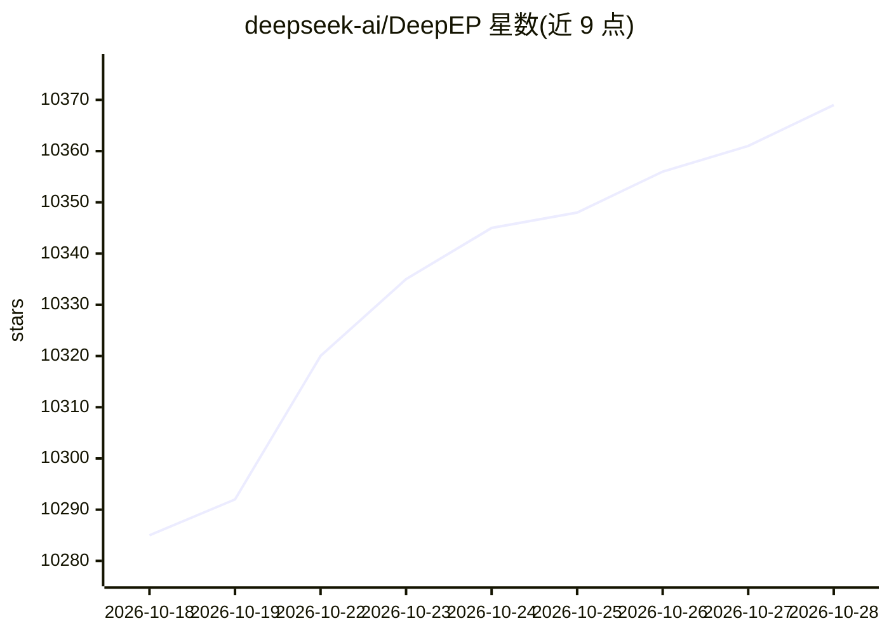

# deepseek-ai/DeepEP

⭐ 10,369 · Cuda · MIT · 推送 2026-10-21 · [GitHub](https://github.com/deepseek-ai/DeepEP) · 组织维护 · 中文 README

**MoE 专家并行的 GPU 通信库：高性能 all-to-all dispatch/combine**

面向机器学习训练与推理的高性能通信库，提供高吞吐、低延迟的专家并行（EP）all-to-all GPU 内核，用于 MoE 的 dispatch 与 combine，含 FP8 dispatch、冗余专家的 NVLink 权重与梯度交换，以及实验性的流水线并行、上下文并行、数据并行原语与远程内存访问（Engram）。通信内核在运行时经 DeepJIT 编译，宿主 C++ 扩展在安装期构建。要求 Linux、Python 3.10+、NVIDIA Hopper 及以上 GPU、CUDA Toolkit 13.1+、PyTorch 2.10+、NCCL 2.32.3+，节点内需 NVLink、节点间需 RDMA；另有华为昇腾 950 NPU 版本（DeepEP-Ascend）。EP dispatch/combine 需占用 GPU SM，零 SM 的 RDMA EP 不支持。

## 筛选速览

| 维度 | 判定 | 备注 |
|---|---|---|
| AI 角色 | `ai-ecosystem` | LLM/agent 周边工具 |
| 许可风险 | `permissive` | MIT |
| 部署形态 | `library` | 以包/库形式分发 |
| 模型依赖 | — | README 未给出锁定关系 |
| 硬件要求 | — | 无带数字的原话,不猜 |
| 安装摩擦 | `medium` | 含编译或系统依赖之一 |
| 成熟度 | `idea` | |

## 能力要点

- 高吞吐与低延迟 EP all-toall dispatch/combine 统一于 EPBuffer 接口，含 FP8 dispatch
- DeepJIT 运行时按当前设备编译通信内核，安装期无需可见 GPU
- 实验性 PP/CP/DP 集合通信（BucketBuffer）与 RDMA 远程内存访问（Engram）
- 冗余专家的 NVLink 权重预取与 FP32 梯度归约原语

## 适用场景

- MoE 模型训练与推理中实现专家并行通信
- 多节点集群上做大规模 MoE 的 dispatch/combine
- 通过专家复制做负载均衡的通信支撑

## 场景标签

 · 领域:分布式训练/通信库

## 证据(README 行号)

> L3: DeepEP (DeepEveryParallel) is a high-performance communication library for machine learning training and inference. 
> L29:  - High-throughput and low-latency APIs unified into a single `EPBuffer` interface, with an expanded layout for gro

## 星数曲线

2026-10-18 10,285 → 2026-10-28 10,369（+84）

---
*卡片 v1 · prompt 1.4 · 生成 2026-10-20 · 置信度 mid · 依据 README sha `faf658febc53` · [字段定义](../../DATASET.md)*
