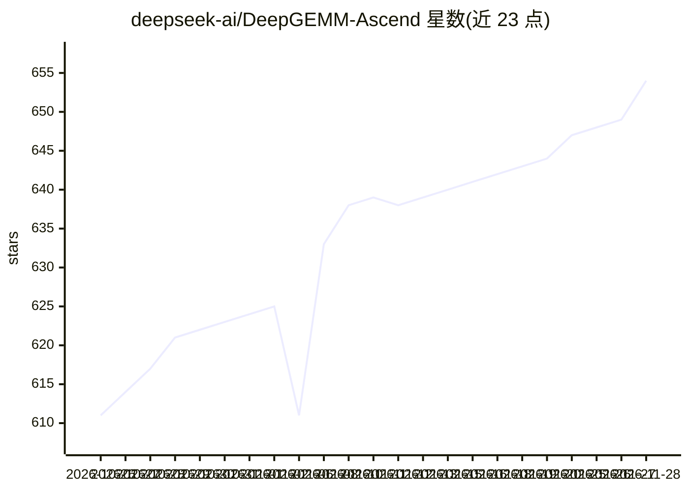

# deepseek-ai/DeepGEMM-Ascend

⭐ 654 · C++ · MIT · 推送 2026-11-26 · [GitHub](https://github.com/deepseek-ai/DeepGEMM-Ascend) · 组织维护 · 中文 README

**昇腾 NPU 上的 GEMM 矩阵乘 kernel 库，兼容 DeepGEMM API**

将 DeepGEMM 移植到华为昇腾平台的矩阵乘法 kernel 库，与上游 DeepGEMM 完全 API 兼容，支持 BF16/FP8/FP4 GEMM、混合精度 GEMM、MQA logits 与 MegaMoE 算子。对昇腾 MAD 原语做轻量抽象，隐藏分形布局、对齐约束等底层细节，采用稀疏数据加载、协程流水线等平台优化，并提供 JIT 编译缓存与调试环境变量。面向在昇腾 950 系列上部署 DeepSeek 系列模型推理与训练工作负载的开发者。

## 筛选速览

| 维度 | 判定 | 备注 |
|---|---|---|
| AI 角色 | `ai-ecosystem` | LLM/agent 周边工具 |
| 许可风险 | `permissive` | MIT |
| 部署形态 | `library` | 以包/库形式分发 |
| 模型依赖 | — | README 未给出锁定关系 |
| 硬件要求 | — | 无带数字的原话,不猜 |
| 安装摩擦 | `low` | 无编译、无系统依赖或容器化 |
| 成熟度 | — | 结构信号不足 |

## 能力要点

- 与 DeepGEMM 完全 API 兼容，沿用相同包名与开发流程
- 支持 BF16/FP8/FP4 及混合 FP8×FP4 GEMM、MQA logits、MegaMoE 融合算子
- 提供 set_num_sms、确定性算法开关等运行时控制工具函数
- JIT 编译缓存目录、调试与超时等环境变量配置

## 适用场景

- 在昇腾 NPU 上为 DeepSeek 模型推理提供 GEMM 算子
- MoE 专家分组的 grouped GEMM 计算
- 参考其实现做昇腾平台极致性能优化

## 场景标签

 · 领域:AI 基础设施/计算算子

## 证据(README 行号)

> L3: DeepGEMM Ascend is a port of DeepGEMM to the HUAWEI Ascend platform. It is fully API-compatible with DeepGEMM and su
> L5: DeepGEMM Ascend provides a lightweight abstraction over the Ascend MAD (matrix multiply-add) primitives, hiding much
> L25: - CANN 9.3.0 toolkit providing `bin/bisheng`, `bin/ld.lld`, with `aclnnGemmSyrk` headers and library installed

## 星数曲线

2026-10-26 611 → 2026-11-28 654（+43）

---
*卡片 v1 · prompt 1.4 · 生成 2026-11-27 · 置信度 high · 依据 README sha `13b3339072f2` · [字段定义](../../DATASET.md)*
