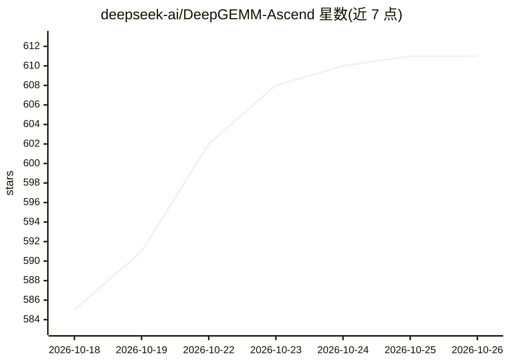

# deepseek-ai/DeepGEMM-Ascend

⭐ 611 · C++ · MIT · 推送 2026-10-14 · [GitHub](https://github.com/deepseek-ai/DeepGEMM-Ascend) · 组织维护 · 中文 README

**华为昇腾 NPU 上的 DeepGEMM 矩阵乘 kernel 库移植**

deepseek-ai 维护的 GEMM kernel 库，将 DeepGEMM 移植到华为昇腾平台，完全兼容其 API，支持 BF16、FP8、FP4 GEMM、MQA logits 与 MegaMoE 算子。对昇腾 MAD 原语做轻量抽象，隐藏分形布局与对齐约束等细节，采用稀疏数据加载、协程流水线等优化，配套 JIT 编译运行时。要求昇腾 NPU（Ascend 950 系列验证）、CANN 9.20 工具包、torch_npu 与 Python 3.10+，源码构建需 C++20 编译器。

## 筛选速览

| 维度 | 判定 | 备注 |
|---|---|---|
| AI 角色 | `ai-ecosystem` | LLM/agent 周边工具 |
| 许可风险 | `permissive` | MIT |
| 部署形态 | `library` | 以包/库形式分发 |
| 模型依赖 | — | README 未给出锁定关系 |
| 硬件要求 | — | 无带数字的原话,不猜 |
| 安装摩擦 | `low` | 无编译、无系统依赖或容器化 |
| 成熟度 | — | 结构信号不足 |

## 能力要点

- BF16/FP8/FP4 GEMM、MQA logits、MegaMoE 算子，API 兼容 DeepGEMM
- 对昇腾 MAD 原语的轻量抽象，隐藏分形布局与对齐约束
- JIT 编译运行时，含缓存目录、调试与确定性算法开关等环境变量
- Dense GEMM 在 Ascend 950DT 上实测达硬件上限 99.8%

## 适用场景

- 在昇腾 NPU 上运行 DeepSeek 系列模型的推理与训练算子
- 昇腾平台极致性能优化的参考实现
- 沿用 DeepGEMM API 将现有 GEMM 工作流迁移到昇腾硬件

## 场景标签

`推理引擎` · 领域:训练与推理

## 证据(README 行号)

> L3: DeepGEMM Ascend is a port of DeepGEMM to the HUAWEI Ascend platform. It is fully API-compatible with DeepGEMM and su
> L5: DeepGEMM Ascend provides a lightweight abstraction over the Ascend MAD (matrix multiply-add) primitives, hiding much

## 星数曲线

2026-10-18 585 → 2026-10-26 611（+26）

---
*卡片 v1 · prompt 1.4 · 生成 2026-10-21 · 置信度 high · 依据 README sha `d4d248ac4946` · [字段定义](../../DATASET.md)*
