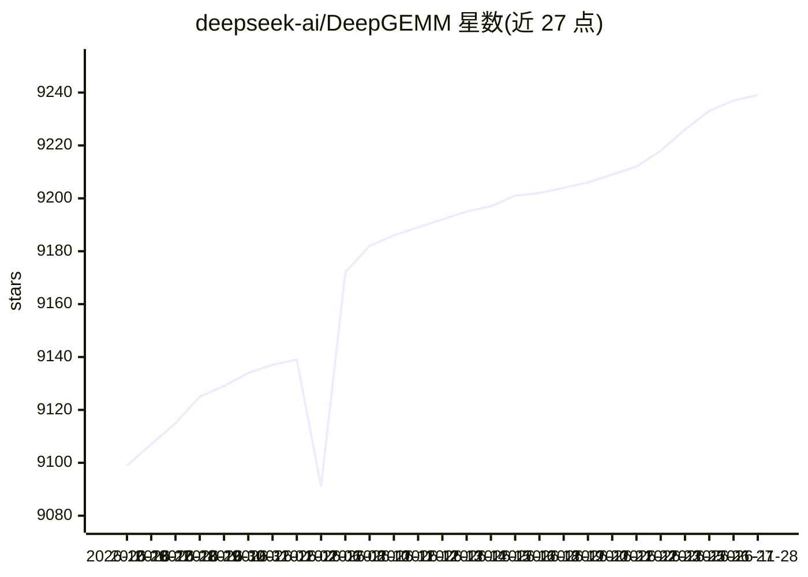

# deepseek-ai/DeepGEMM

⭐ 9,239 · Cuda · MIT · 推送 2026-11-26 · [GitHub](https://github.com/deepseek-ai/DeepGEMM) · 组织维护

**面向 LLM 计算的 GPU 张量核 BLAS 核函数库**

统一的 CUDA 张量核核函数库，汇集大语言模型的关键计算原语：FP8/FP4/BF16 GEMM、带重叠通信的融合 MoE（Mega MoE）、lightning indexer 的 MQA 打分、HyperConnection 等。所有核函数在运行时通过 DeepJIT 编译，安装时无需 CUDA 编译。要求 NVIDIA SM90/SM100 GPU、CUDA Toolkit 12.9+、PyTorch 2.3+ 与支持 C++20 的编译器；仅包含有限数量的核心核函数，面向学习 NVIDIA GPU 核函数优化技术的读者。

## 筛选速览

| 维度 | 判定 | 备注 |
|---|---|---|
| AI 角色 | `ai-native` | 本体是模型或模型工具 |
| 许可风险 | `permissive` | MIT |
| 部署形态 | `None` |  |
| 模型依赖 | locked-api |  |
| 硬件要求 | — | 无带数字的原话,不猜 |
| 安装摩擦 | `medium` | 含编译或系统依赖之一 |
| 成熟度 | — | 结构信号不足 |

## 能力要点

- 提供 FP8、FP4、BF16 GEMM 核函数（dense 与 grouped 布局）
- Mega MoE 融合推理核函数带对称缓冲与重叠通信
- 所有核函数运行时经 DeepJIT 编译，安装时无需 CUDA 编译
- 提供 SM 数量、PDL、确定性算法等运行时配置工具函数

## 适用场景

- 为 MoE 模型训练前向与推理解码提供 grouped GEMM 计算
- 复用 DeepSeek v3.2 lightning indexer 的 MQA 打分核函数
- 学习 NVIDIA GPU 张量核核函数优化技术

## 场景标签

 · 领域:AI 基础设施/GPU 计算

## 证据(README 行号)

> L3: DeepGEMM is a unified, high-performance tensor core kernel library that brings together the key computation primitiv
> L62: This library provides optimized GEMM kernels for NVIDIA GPUs with a naming convention: `D = C + A @ B`. The input s

## 星数曲线

2026-10-26 9,099 → 2026-11-28 9,239（+140）

---
*卡片 v1 · prompt 1.4 · 生成 2026-11-27 · 置信度 high · 依据 README sha `ae5d0b8dbd34` · [字段定义](../../DATASET.md)*
