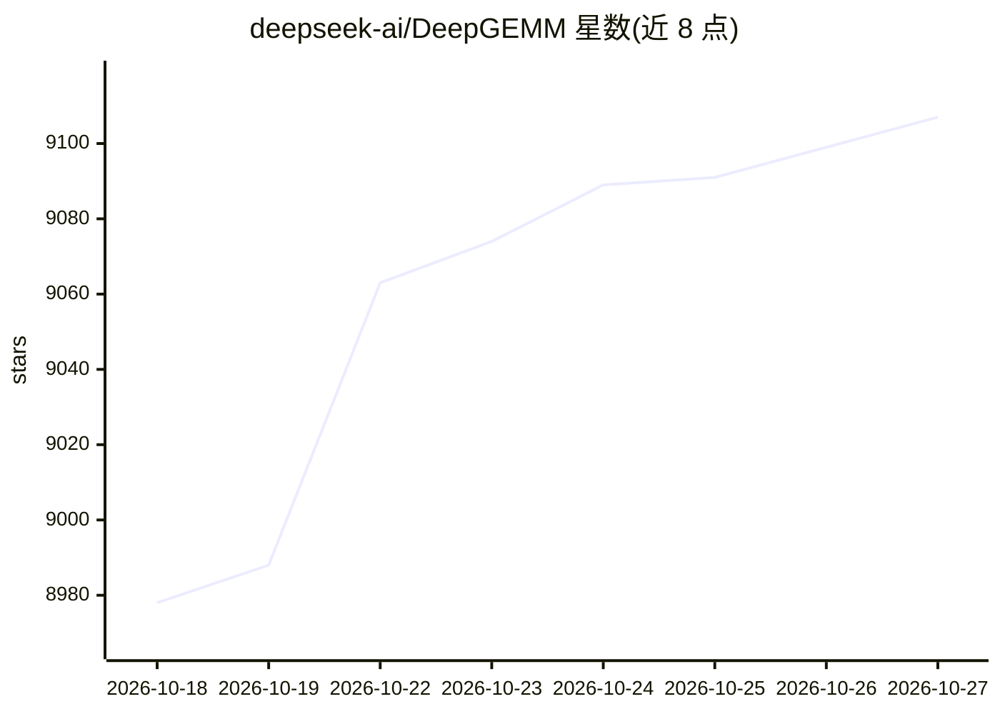

# deepseek-ai/DeepGEMM

⭐ 9,107 · Cuda · MIT · 推送 2026-10-20 · [GitHub](https://github.com/deepseek-ai/DeepGEMM) · 组织维护 · 中文 README

**面向 LLM 推理/训练的 GPU 张量核心算子库（FP8/FP4/BF16 GEMM、MoE 融合核）**

DeepSeek 维护的 CUDA 核函数库，把现代大语言模型的关键计算原语（FP8/FP4/BF16 稠密与分组 GEMM、融合 MoE 的 Mega MoE、lightning indexer 的 MQA 打分核、HyperConnection 等）集中到单一代码库，通过 DeepJIT 在运行时编译，安装阶段无需 CUDA 编译。面向在 NVIDIA SM90/SM100 GPU 上开发训练或推理后端的工程师；要求 CUDA 12.9+、PyTorch 2.3+、CUTLASS 4.0+，SM90 仅支持 NT 布局、SM100 支持全部布局，转置与 FP8 转换需用户自行处理。以 MIT 许可发布。

## 筛选速览

| 维度 | 判定 | 备注 |
|---|---|---|
| AI 角色 | `ai-ecosystem` | LLM/agent 周边工具 |
| 许可风险 | `permissive` | MIT |
| 部署形态 | `None` |  |
| 模型依赖 | — | README 未给出锁定关系 |
| 硬件要求 | — | 无带数字的原话,不猜 |
| 安装摩擦 | `medium` | 含编译或系统依赖之一 |
| 成熟度 | — | 结构信号不足 |

## 能力要点

- FP8/FP4/BF16 稠密与分组（contiguous/masked）GEMM 核
- Mega MoE 将 EP 通信与线性层/SwiGLU 融合为单一 mega-kernel
- DeepJIT 运行时编译，安装无需 CUDA 编译
- 面向 DeepSeek V3.2 indexer 的 MQA logits 核（非分页/分页两版）

## 适用场景

- 为 MoE 模型训练与推理实现高性能 GEMM 后端
- 在 CUDA graph 推理解码阶段使用 masked 分组 GEMM
- 学习 NVIDIA GPU 核函数优化技术（代码结构简洁）

## 场景标签

 · 领域:GPU 高性能计算/LLM 算子库

## 证据(README 行号)

> L3: DeepGEMM is a unified, high-performance tensor core kernel library that brings together the key computation primitiv
> L31: - NVIDIA SM90 or SM100 architecture GPU

## 星数曲线

2026-10-18 8,978 → 2026-10-27 9,107（+129）

---
*卡片 v1 · prompt 1.4 · 生成 2026-10-20 · 置信度 high · 依据 README sha `ee906d9abc0f` · [字段定义](../../DATASET.md)*
