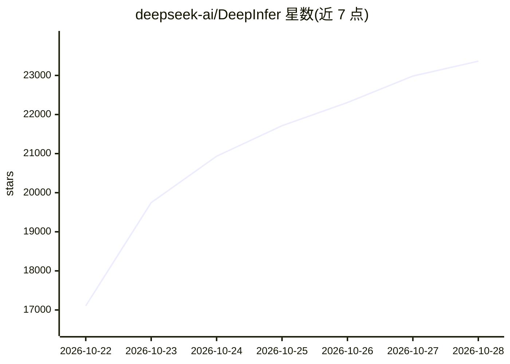

# deepseek-ai/DeepInfer

⭐ 23,365 · Python · Apache-2.0 · 推送 2026-10-26 · [GitHub](https://github.com/deepseek-ai/DeepInfer) · 组织维护 · 中文 README

**DeepSeek 模型的高性能大规模推理框架**

DeepSeek 官方开源的生产级推理框架，支撑其大规模线上服务，本次发布提供离线推理能力。支持 DeepSeek-V4.1-Flash 模型，特性包括 FlashMLA/DeepGEMM/DeepEP 等优化内核、注意力 DP 与 MoE EP+EPLB 并行、DSpark 草稿token加速解码、异步调度、批不变推理、确定性采样与结构化输出（regex/JSON schema/EBNF）。硬件支持 NVIDIA SM100 GPU 与华为昇腾 950 NPU，需 Linux + GCC>=13 + Python 3.12 从源码构建。完整在线服务还需 KV cache、PD 分离与负载均衡，未包含在本发布中。

## 筛选速览

| 维度 | 判定 | 备注 |
|---|---|---|
| AI 角色 | `ai-ecosystem` | LLM/agent 周边工具 |
| 许可风险 | `permissive` | Apache-2.0 |
| 部署形态 | `None` |  |
| 模型依赖 | locked-api |  |
| 硬件要求 | — | 无带数字的原话,不猜 |
| 安装摩擦 | `high` | 编译与系统依赖俱全 |
| 成熟度 | — | 结构信号不足 |

## 能力要点

- FlashMLA/DeepGEMM/DeepEP 等优化内核与 MoE EP+EPLB 并行
- DSpark 草稿token与置信度调度验证加速解码
- 批不变推理与确定性采样（NVIDIA）
- 结构化输出：regex / JSON schema / EBNF 语法约束

## 适用场景

- 在生产环境大规模部署 DeepSeek 模型推理
- 离线批量推理与性能基准测试
- 需要确定性输出或结构化生成的推理任务

## 场景标签

`推理引擎` · 领域:训练与推理

## 证据(README 行号)

> L3: DeepInfer is the high-performance inference framework that powers DeepSeek's large-scale production services. This o
> L12: - Parallelism: Attention DP / balanced CP, MoE EP + EPLB

## 星数曲线

2026-10-22 17,105 → 2026-10-28 23,365（+6,260）

---
*卡片 v1 · prompt 1.4 · 生成 2026-10-21 · 置信度 high · 依据 README sha `5899261f0917` · [字段定义](../../DATASET.md)*
