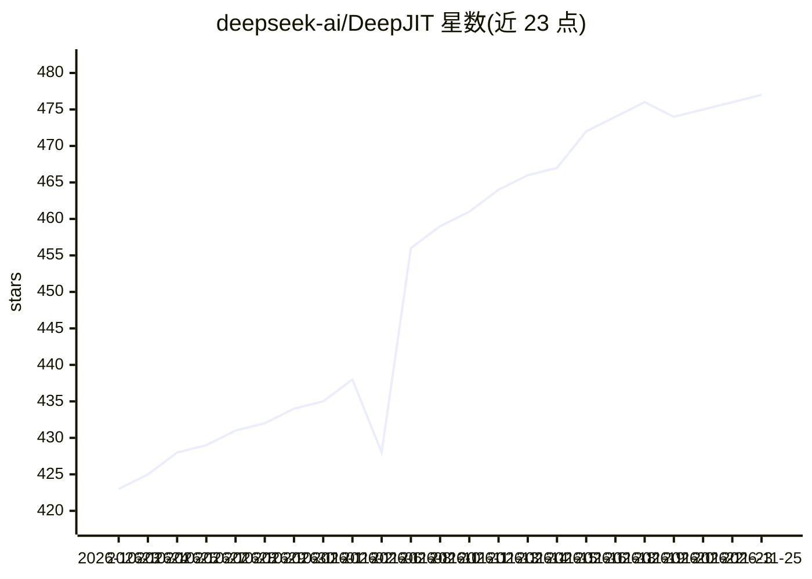

# deepseek-ai/DeepJIT

⭐ 477 · C++ · MIT · 推送 2026-11-23 · [GitHub](https://github.com/deepseek-ai/DeepJIT) · 组织维护 · 中文 README

**给 C++/Python 扩展作者的 xPU 内核运行时编译缓存库**

header-only 的 C++20 JIT 运行时，供内核库作者在运行时编译、缓存、加载并启动 CUDA GPU 与昇腾 NPU 上的内核代码。两种后端共用同一 compile/load/launch 接口、运行时配置、源码与 include 哈希、内存及磁盘缓存和延迟初始化；支持本地与分布式文件系统的共享缓存、多用户权限（SGID）配置、PyTorch 流集成与 pybind11 的 get_jit() 注册。以头文件形式嵌入使用者自己的扩展，无独立安装包；缓存相关的编译/启动选项仍由所选后端决定。

## 筛选速览

| 维度 | 判定 | 备注 |
|---|---|---|
| AI 角色 | `ai-ecosystem` | LLM/agent 周边工具 |
| 许可风险 | `permissive` | MIT |
| 部署形态 | `None` |  |
| 模型依赖 | — | README 未给出锁定关系 |
| 硬件要求 | — | 无带数字的原话,不猜 |
| 安装摩擦 | `medium` | 含编译或系统依赖之一 |
| 成熟度 | — | 结构信号不足 |

## 能力要点

- CUDA 与 Ascend 双后端共用同一 Runtime<CUDA/Ascend> 编译加载接口
- 内核缓存键涵盖源码、tracked includes、编译器版本与编译选项
- 支持多用户/多进程/多节点共享磁盘缓存与 SGID 权限管理
- 延迟初始化与 PyTorch CUDA / torch_npu 流默认集成

## 适用场景

- 给 CUDA/Ascend 内核库加上运行时编译与二进制缓存
- 多节点集群共享编译产物以避免重复编译
- 在 pybind11 扩展中暴露进程级 JIT 运行时

## 场景标签

 · 领域:AI 基础设施/内核编译

## 证据(README 行号)

> L3: DeepJIT is a lightweight, header-only C++20 JIT runtime for **NVIDIA CUDA GPUs** and **HUAWEI Ascend (昇腾) NPUs**. It
> L11: - **CUDA and Ascend backends:** use `deep_jit::Runtime<deep_jit::CUDA>` or `deep_jit::Runtime<deep_jit::Ascend>` wi

## 星数曲线

2026-10-23 423 → 2026-11-25 477（+54）

---
*卡片 v1 · prompt 1.4 · 生成 2026-11-25 · 置信度 high · 依据 README sha `7eae553f49d2` · [字段定义](../../DATASET.md)*
