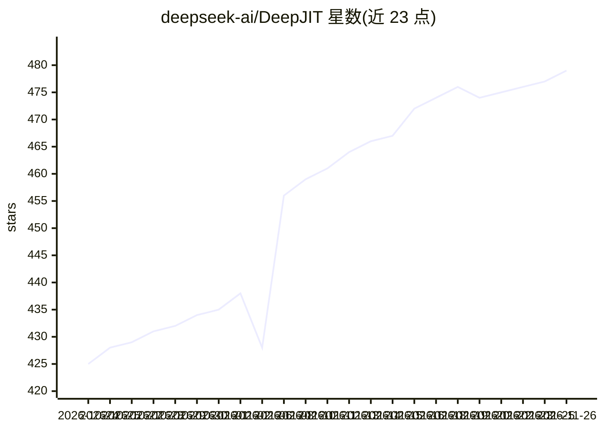

# deepseek-ai/DeepJIT

⭐ 479 · C++ · MIT · 推送 2026-11-24 · [GitHub](https://github.com/deepseek-ai/DeepJIT) · 组织维护 · 中文 README

**给 C++/Python 扩展作者的 CUDA/昇腾内核 JIT 编译运行时**

header-only 的 C++20 JIT 运行时库，嵌入到 C++/Python 扩展中，在运行时编译内核源码、缓存产物、加载到设备并启动。提供 CUDA（NVCC→CUBIN）与华为昇腾 NPU（Bisheng/ld.lld→ACL）两个后端，共用同一套 compile/load/launch 接口。机制包括内存/磁盘内核缓存、缓存键基于源码与 include 哈希、跨用户/进程/节点的共享缓存目录（SGID 权限处理）、惰性初始化，以及通过 pybind11 暴露 get_jit() 的 PyTorch 流集成。仅支持 Linux，无包管理器安装，以头文件形式被集成。

## 筛选速览

| 维度 | 判定 | 备注 |
|---|---|---|
| AI 角色 | `ai-ecosystem` | LLM/agent 周边工具 |
| 许可风险 | `permissive` | MIT |
| 部署形态 | `None` |  |
| 模型依赖 | — | README 未给出锁定关系 |
| 硬件要求 | — | 无带数字的原话,不猜 |
| 安装摩擦 | `medium` | 含编译或系统依赖之一 |
| 成熟度 | — | 结构信号不足 |

## 能力要点

- CUDA 与昇腾双后端共用同一 compile/load/launch 工作流
- 内存与磁盘内核缓存，缓存键含源码、include、编译器版本与选项
- 支持本地与分布式文件系统的共享缓存目录（SGID、多根回退）
- 通过 pybind11 注册 get_jit()，默认使用当前 PyTorch CUDA/torch_npu 流

## 适用场景

- 为 CUDA/昇腾内核库复用运行时编译与缓存基础设施
- 多用户多节点集群共享编译产物缓存以缩短编译时间
- 在 PyTorch 扩展中嵌入内核 JIT 能力

## 场景标签

 · 领域:AI 基础设施/内核编译

## 证据(README 行号)

> L3: DeepJIT is a lightweight, header-only C++20 JIT runtime for **NVIDIA CUDA GPUs** and **HUAWEI Ascend (昇腾) NPUs**. It
> L5: DeepJIT handles the JIT infrastructure so that kernel libraries can focus on their device code. Both backends share 
> L30: The host environment must provide Linux, a C++20 compiler and standard library with `std::format` support, and the 

## 星数曲线

2026-10-24 425 → 2026-11-26 479（+54）

---
*卡片 v1 · prompt 1.4 · 生成 2026-11-26 · 置信度 high · 依据 README sha `bcdef1d4842e` · [字段定义](../../DATASET.md)*
