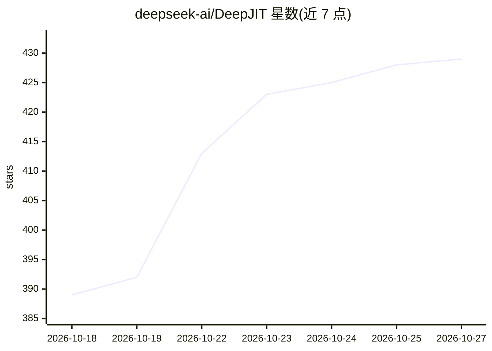

# deepseek-ai/DeepJIT

⭐ 429 · C++ · MIT · 推送 2026-10-19 · [GitHub](https://github.com/deepseek-ai/DeepJIT) · 组织维护 · 中文 README

**面向 C++/Python 扩展作者的 CUDA/昇腾内核 JIT 编译运行时**

header-only C++20 库，为 NVIDIA CUDA GPU 与华为昇腾 NPU 提供统一的内核 JIT 基础设施：运行时编译内核源码、基于源码/头文件/编译器版本的哈希做内存与磁盘缓存、加载并按后端特定选项启动内核。支持共享缓存目录跨用户/进程/节点复用、惰性初始化、PyTorch CUDA 与 torch_npu 流集成，可 dump PTX/SASS 或昇腾汇编。要求 Linux、C++20 编译器，CUDA 需 12.4+ 头文件与 NVCC 12.9+，昇腾需 CANN 工具链；以头文件形式嵌入使用方扩展，不以独立包分发。缓存预热与 Python 编译 API 尚在开发中。

## 筛选速览

| 维度 | 判定 | 备注 |
|---|---|---|
| AI 角色 | `ai-ecosystem` | LLM/agent 周边工具 |
| 许可风险 | `permissive` | MIT |
| 部署形态 | `None` |  |
| 模型依赖 | — | README 未给出锁定关系 |
| 硬件要求 | — | 无带数字的原话,不猜 |
| 安装摩擦 | `medium` | 含编译或系统依赖之一 |
| 成熟度 | `idea` | |

## 能力要点

- CUDA 与昇腾双后端共享同一 compile/load/launch 接口
- 内存+磁盘两级内核缓存，支持分布式文件系统上的共享缓存与原子发布
- 默认使用当前 PyTorch CUDA / torch_npu 流，经 pybind11 暴露 get_jit()
- 支持编译诊断、PTX/SASS/昇腾汇编 dump 与 CUDA Python 后编译钩子

## 适用场景

- 内核库作者在运行时编译并缓存 CUDA/昇腾内核，免去自行搭建 JIT 基础设施
- 多用户集群共享已编译内核缓存以减少重复编译
- C++/Python 扩展在同一代码库里同时支持 GPU 与 NPU 后端

## 场景标签

 · 领域:异构计算/深度学习基础设施

## 证据(README 行号)

> L3: DeepJIT is a lightweight, header-only C++20 JIT runtime for **NVIDIA CUDA GPUs** and **HUAWEI Ascend (昇腾) NPUs**. It
> L5: DeepJIT handles the JIT infrastructure so that kernel libraries can focus on their device code. Both backends share 

## 星数曲线

2026-10-18 389 → 2026-10-27 429（+40）

---
*卡片 v1 · prompt 1.4 · 生成 2026-10-21 · 置信度 high · 依据 README sha `0d34267a7b4f` · [字段定义](../../DATASET.md)*
