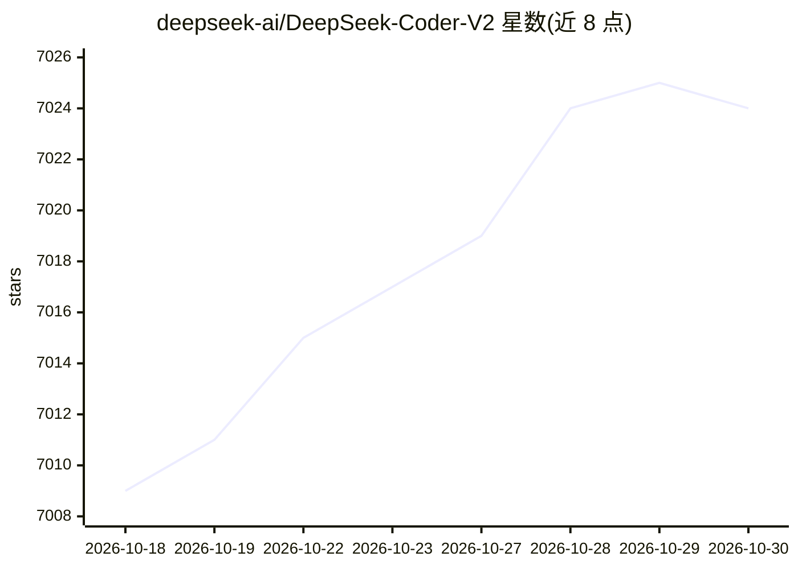

# deepseek-ai/DeepSeek-Coder-V2

⭐ 7,024 · MIT · 推送 2025-11-11 · [GitHub](https://github.com/deepseek-ai/DeepSeek-Coder-V2) · 组织维护 · 中文 README

**开源 MoE 代码大模型：面向开发者的代码生成与数学推理**

DeepSeek-Coder-V2 是基于 DeepSeekMoE 框架的开源代码语言模型，从 DeepSeek-V2 中间检查点继续预训练 6 万亿 token 而来。发布 16B（激活 2.4B）与 236B（激活 21B）参数的 Base/Instruct 版本，上下文 128K，支持 338 种编程语言，用于代码生成、补全、修复与数学推理。可通过 Transformers/SGLang/vLLM 本地推理，BF16 全量版需 8×80GB GPU；另提供官网对话与 OpenAI 兼容 API。模型许可支持商用。

## 筛选速览

| 维度 | 判定 | 备注 |
|---|---|---|
| AI 角色 | `ai-native` | 本体是模型或模型工具 |
| 许可风险 | `permissive` | MIT |
| 部署形态 | `None` |  |
| 模型依赖 | local-ok | 支持本地模型 |
| 硬件要求 | — | 无带数字的原话,不猜 |
| 安装摩擦 | `low` | 无编译、无系统依赖或容器化 |
| 成熟度 | — | 结构信号不足 |

## 能力要点

- 16B/236B 两种规模的 MoE 模型，激活参数仅 2.4B/21B，上下文 128K
- 支持 338 种编程语言，覆盖代码生成、补全、修复与数学推理
- 提供 Transformers、SGLang（含 FP8/MLA 优化）、vLLM 推理方式与 OpenAI 兼容 API

## 适用场景

- 本地部署或通过 API 使用开源代码模型辅助编程
- 在 IDE 或代码工具链中集成代码补全与生成能力
- 评测对比开源与闭源模型在代码和数学基准上的表现

## 场景标签

`代码生成` · 领域:编码与开发

## 证据(README 行号)

> L44: We present DeepSeek-Coder-V2, an open-source Mixture-of-Experts (MoE) code language model that achieves performance
> L50: We release the DeepSeek-Coder-V2 with 16B and 236B parameters based on the DeepSeekMoE framework, which has actived
> L139: Evaluation results on the ``Needle In A Haystack`` (NIAH) tests. DeepSeek-Coder-V2 performs well across all contex

## 星数曲线

2026-10-18 7,009 → 2026-10-30 7,024（+15）

---
*卡片 v1 · prompt 1.4 · 生成 2026-10-20 · 置信度 high · 依据 README sha `0dbb0582f398` · [字段定义](../../DATASET.md)*
