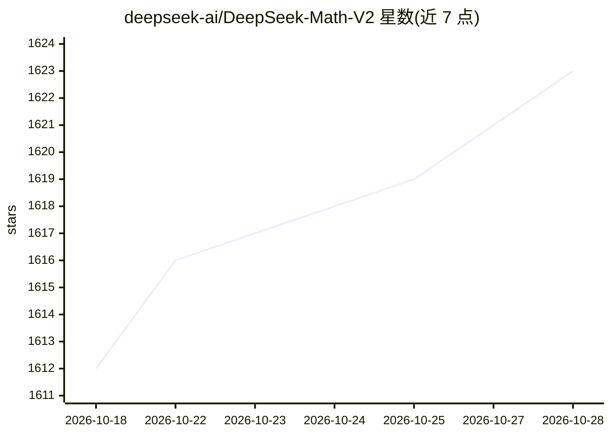

# deepseek-ai/DeepSeek-Math-V2

⭐ 1,625 · Python · Apache-2.0 · 推送 2025-12-01 · [GitHub](https://github.com/deepseek-ai/DeepSeek-Math-V2) · 组织维护 · 中文 README

**数学定理证明大模型：自验证推理，IMO/CMP 金牌水平**

DeepSeek 发布的数学推理大模型权重，基于 DeepSeek-V3.2-Exp-Base 训练。核心机制：训练 LLM 证明验证器作为奖励模型，再用其训练证明生成器，并通过扩展验证算力自动标注难验证证明形成新训练数据，实现生成与验证同步提升。在 IMO 2025 与 CMO 2024 取得金牌水平，Putnam 2024 得 118/120；推理支持需参照 DeepSeek-V3.2-Exp 仓库，模型预测输出在 outputs 目录提供。

## 筛选速览

| 维度 | 判定 | 备注 |
|---|---|---|
| AI 角色 | `ai-native` | 本体是模型或模型工具 |
| 许可风险 | `permissive` | Apache-2.0 |
| 部署形态 | `None` |  |
| 模型依赖 | locked-api |  |
| 硬件要求 | — | 无带数字的原话,不猜 |
| 安装摩擦 | `low` | 无编译、无系统依赖或容器化 |
| 成熟度 | — | 结构信号不足 |

## 能力要点

- 训练 LLM-based 定理证明验证器并作为生成器奖励模型
- 扩展验证算力自动标注新证明，持续提升验证器
- IMO 2025 / CMO 2024 金牌级，Putnam 2024 118/120
- 基于 DeepSeek-V3.2-Exp-Base，权重托管于 HuggingFace

## 适用场景

- 数学竞赛级定理证明与证明生成任务
- 研究自验证推理与生成-验证差距的扩展方法
- 复现论文评测结果（模型预测已随仓库提供）

## 场景标签

 · 领域:AI/数学推理

## 证据(README 行号)

> L34: Towards self-verifiable mathematical reasoning, we investigate how to train an accurate and faithful LLM-based veri
> L37: Our resulting model, DeepSeekMath-V2, demonstrates strong theorem-proving capabilities, achieving gold-level scores

## 星数曲线

2026-10-18 1,612 → 2026-10-28 1,623（+11）

---
*卡片 v1 · prompt 1.4 · 生成 2026-10-21 · 置信度 high · 依据 README sha `9b0b3ad8ff62` · [字段定义](../../DATASET.md)*
