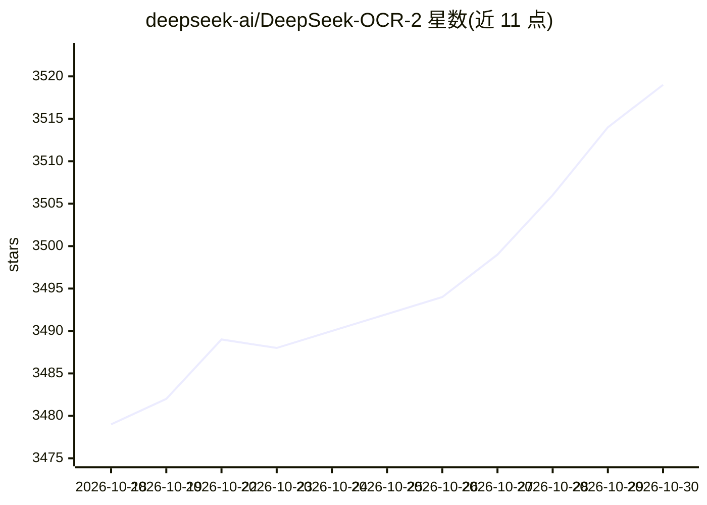

# deepseek-ai/DeepSeek-OCR-2

⭐ 3,519 · Python · Apache-2.0 · 推送 2026-02-03 · [GitHub](https://github.com/deepseek-ai/DeepSeek-OCR-2) · 组织维护 · 中文 README

**DeepSeek 开源 OCR 模型：文档图像转 Markdown 的视觉编码**

DeepSeek AI 发布的 OCR 模型仓库，以“Visual Causal Flow”方式做类人视觉编码，支持文档图像/ PDF 转 Markdown、无版式自由 OCR 与 grounding 提示词。提供 vLLM 与 Transformers 两条推理路径：vLLM 路径支持图像流式输出、PDF 并发处理与 OmniDocBench 批量评测；动态分辨率默认 (0-6)×768×768 + 1×1024×1024，产生 (0-6)×144+256 个视觉 token。环境要求 cuda11.8+torch2.6.0，模型权重托管于 Hugging Face。

## 筛选速览

| 维度 | 判定 | 备注 |
|---|---|---|
| AI 角色 | `ai-native` | 本体是模型或模型工具 |
| 许可风险 | `permissive` | Apache-2.0 |
| 部署形态 | `library` | 以包/库形式分发 |
| 模型依赖 | local-ok | 支持本地模型 |
| 硬件要求 | — | 无带数字的原话,不猜 |
| 安装摩擦 | `medium` | 含编译或系统依赖之一 |
| 成熟度 | — | 结构信号不足 |

## 能力要点

- 文档图像/PDF 转 Markdown，支持 grounding 与自由 OCR 两种提示模式
- vLLM 与 Transformers 双推理路径，PDF 并发处理
- 动态分辨率：默认 (0-6)×768×768 + 1×1024×1024，对应 (0-6)×144+256 视觉 token
- 提供 OmniDocBench v1.5 批量评测脚本

## 适用场景

- 把扫描文档或 PDF 批量转换为 Markdown
- 在文档理解基准上评测 OCR 模型
- 通过 Transformers 或 vLLM 集成到自有文档处理流水线

## 场景标签

`OCR` · 领域:感知与多模态

## 证据(README 行号)

> L23:  DeepSeek-OCR 2: Visual Causal Flow
> L89: # document: <image>\n<|grounding|>Convert the document to markdown.
> L90: # without layouts: <image>\nFree OCR.

## 星数曲线

2026-10-18 3,479 → 2026-10-30 3,519（+40）

---
*卡片 v1 · prompt 1.4 · 生成 2026-10-20 · 置信度 high · 依据 README sha `15a97b1f5724` · [字段定义](../../DATASET.md)*
