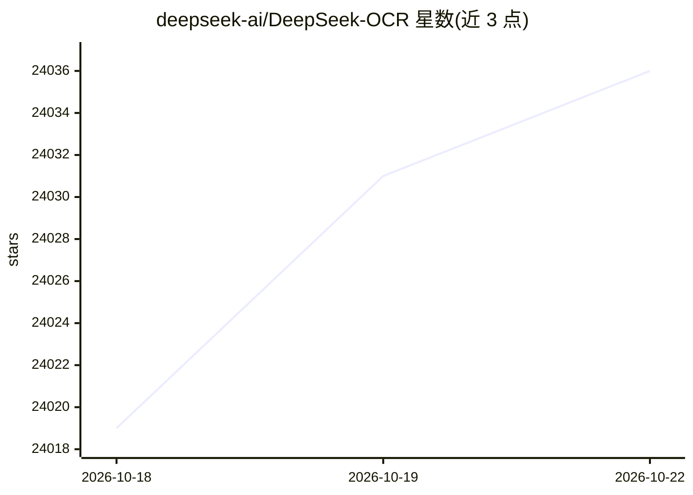

# deepseek-ai/DeepSeek-OCR

⭐ 24,044 · Python · MIT · 推送 2026-01-27 · [GitHub](https://github.com/deepseek-ai/DeepSeek-OCR) · 组织维护

**面向研究者的视觉文本压缩 OCR 模型**

DeepSeek AI 发布的开源模型，探索从 LLM 中心视角研究视觉编码器的作用，将文本上下文以视觉形式压缩表示。提供 vLLM 与 Transformers 两条推理路径，支持图片流式输出、PDF 处理与基准批量评测，提供 5 种分辨率模式（Tiny 至 Gundam 动态分辨率）与文档转 Markdown、OCR、Free OCR 等 prompt 模板。模型权重发布于 Hugging Face，环境依赖 CUDA 11.8 与 torch 2.6.0，README 注明 vLLM/transformers 同环境安装可能报依赖版本冲突。

## 筛选速览

| 维度 | 判定 | 备注 |
|---|---|---|
| AI 角色 | `ai-native` | 本体是模型或模型工具 |
| 许可风险 | `permissive` | MIT |
| 部署形态 | `library` | 以包/库形式分发 |
| 模型依赖 | local-ok | 支持本地模型 |
| 硬件要求 | — | 无带数字的原话,不猜 |
| 安装摩擦 | `medium` | 含编译或系统依赖之一 |
| 成熟度 | — | 结构信号不足 |

## 动量与使用信号

- 维护:`declining` — 距上次 push 264.2 天,年发版 0,1 位贡献者
- 涨星:近 1 天 **+6**(自 20261016 起算)
- 安装:pypi 包 `torch` 月下载 58,964,343

## 能力要点

- 支持 vLLM 与 Transformers 两条推理路径
- 5 种分辨率模式：512×512 至动态 Gundam 模式
- 提供文档转 Markdown、OCR、Free OCR 等 prompt 模板
- 已获上游 vLLM 官方支持

## 适用场景

- 将图片或 PDF 文档转换为 Markdown 文本
- 批量评测 OCR 基准
- 研究视觉-文本压缩机制

## 场景标签

`OCR` `文档解析` · 领域:知识与检索

## 证据(README 行号)

> L23:  DeepSeek-OCR: Contexts Optical Compression
> L30: - [2025/10/20]🚀🚀🚀 We release DeepSeek-OCR, a model to investigate the role of vision encoders from an LLM-centric v
> L104: The current open-source model supports the following modes:

## 星数曲线

2026-10-18 24,019 → 2026-10-22 24,036（+17）

---
*卡片 v1 · prompt 1.4 · 生成 2026-10-18 · 置信度 high · 依据 README sha `ada43f4108b5` · [字段定义](../../DATASET.md)*
