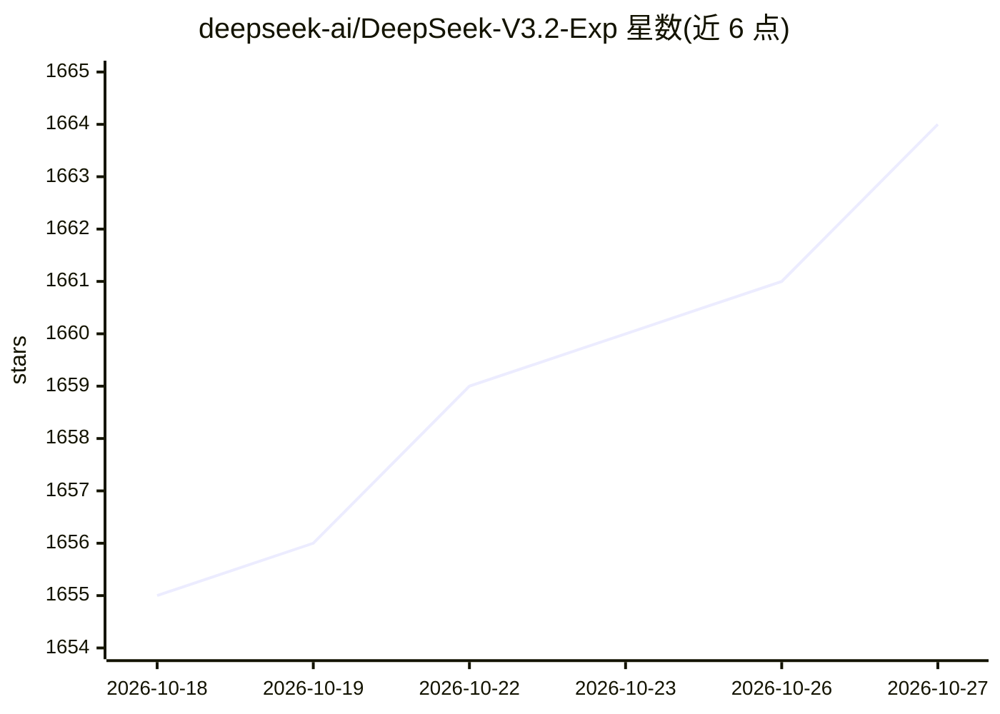

# deepseek-ai/DeepSeek-V3.2-Exp

⭐ 1,664 · Python · MIT · 推送 2025-11-18 · [GitHub](https://github.com/deepseek-ai/DeepSeek-V3.2-Exp) · 组织维护 · 中文 README

**DeepSeek 实验版大模型权重：引入稀疏注意力的 671B MoE 模型**

DeepSeek-AI 发布的实验性开源大模型权重仓库，基于 V3.1-Terminus 训练配置，引入 DeepSeek Sparse Attention（DSA）以验证长上下文训练与推理效率优化，公开基准成绩与 V3.1-Terminus 持平。README 提供本地运行方式：自带 inference 文件夹的推理示例代码（需转换 HuggingFace 权重、torchrun 多卡启动），以及 SGLang（含 Docker 镜像）与 vLLM day-0 支持的部署路径。模型权重与仓库均以 MIT 许可发布。

## 筛选速览

| 维度 | 判定 | 备注 |
|---|---|---|
| AI 角色 | `ai-native` | 本体是模型或模型工具 |
| 许可风险 | `permissive` | MIT |
| 部署形态 | `self-host` | docker 或自建部署 |
| 模型依赖 | local-ok | 支持本地模型 |
| 硬件要求 | — | 无带数字的原话,不猜 |
| 安装摩擦 | `low` | 无编译、无系统依赖或容器化 |
| 成熟度 | `idea` | |

## 能力要点

- DeepSeek Sparse Attention（DSA）细粒度稀疏注意力机制
- 公开 17 项基准测试成绩表（MMLU-Pro、SWE Verified 等）
- 提供权重转换脚本与多卡 torchrun 交互式推理示例
- SGLang Docker 镜像与 vLLM day-0 支持

## 适用场景

- 本地多卡部署并体验 671B 稀疏注意力模型
- 研究长上下文效率优化的注意力架构
- 基于公开基准成绩评估是否用于推理/agent 任务

## 场景标签

 · 领域:大语言模型/模型权重

## 证据(README 行号)

> L33: We are excited to announce the official release of DeepSeek-V3.2-Exp, an experimental version of our model. As an i
> L37: - DeepSeek Sparse Attention (DSA) achieves fine-grained sparse attention for the first time, delivering substantial

## 星数曲线

2026-10-18 1,655 → 2026-10-27 1,664（+9）

---
*卡片 v1 · prompt 1.4 · 生成 2026-10-21 · 置信度 high · 依据 README sha `077c0962acf0` · [字段定义](../../DATASET.md)*
