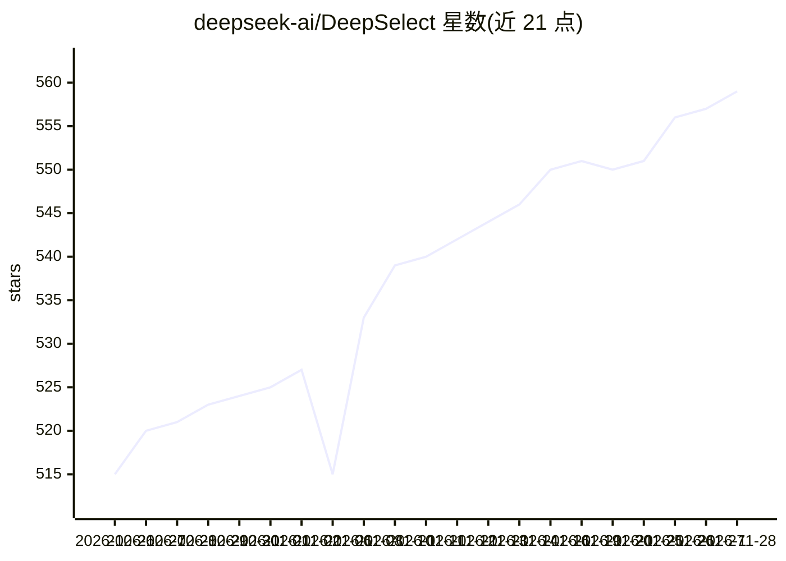

# deepseek-ai/DeepSelect

⭐ 559 · C++ · MIT · 推送 2026-11-26 · [GitHub](https://github.com/deepseek-ai/DeepSelect) · 组织维护 · 中文 README

**给开发者提供 DeepSeek 稀疏注意力用的高性能 TopK 算子**

DeepSelect 是 DeepSeek 官方发布的 TopK 算子库，服务于 DeepSeek 稀疏注意力（DSA，用于 V3.2/V4/V4.1 模型）与采样场景，支持 NVIDIA CUDA 与华为昇腾平台。仅覆盖限定输入条件（bfloat16/float32、topk≤4096，主要面向 topk=512），提供变长行、NaN 检查、输出缓冲对齐等接口控制。需从源码编译安装，README 附基准测试脚本与论文式引用条目。

## 筛选速览

| 维度 | 判定 | 备注 |
|---|---|---|
| AI 角色 | `ai-native` | 本体是模型或模型工具 |
| 许可风险 | `permissive` | MIT |
| 部署形态 | `library` | 以包/库形式分发 |
| 模型依赖 | — | README 未给出锁定关系 |
| 硬件要求 | — | 无带数字的原话,不猜 |
| 安装摩擦 | `medium` | 含编译或系统依赖之一 |
| 成熟度 | — | 结构信号不足 |

## 能力要点

- TopK 算子支持 CUDA 与华为昇腾双平台
- 覆盖 Lightning Indexer 与 Sampling 两类场景，按 dtype/topk 分层优化
- 支持变长行（end 参数）与 NaN 检查（可配置 trap 中止）
- README 提供算法与实现的分析文档（中英文）

## 适用场景

- 为运行 DeepSeek V3.2/V4 系列模型加速 TopK 计算
- 在昇腾 NPU 上复现 DSA 的 TopK 与采样算子
- 对 128K 词表规模的 logits 做批量 topk 提取

## 场景标签

 · 领域:AI 基础设施/算子库

## 证据(README 行号)

> L3: DeepSelect is a high performance implementation of the TopK kernel used in DeepSeek Sparse Attention (DSA) (which is
> L5: DeepSelect 是为 DeepSeek 稀疏注意力（DeepSeek Sparse Attention, DSA）和采样器（Sampler）定制的高性能 TopK 算子，支持 NVIDIA CUDA 平台与华为昇腾（Ascen
> L16: TopK workloads vary widely, and the fastest algorithm & implementation highly depends on the input dtype, `batch_si

## 星数曲线

2026-10-26 515 → 2026-11-28 559（+44）

---
*卡片 v1 · prompt 1.4 · 生成 2026-11-27 · 置信度 mid · 依据 README sha `71ba9e873614` · [字段定义](../../DATASET.md)*
