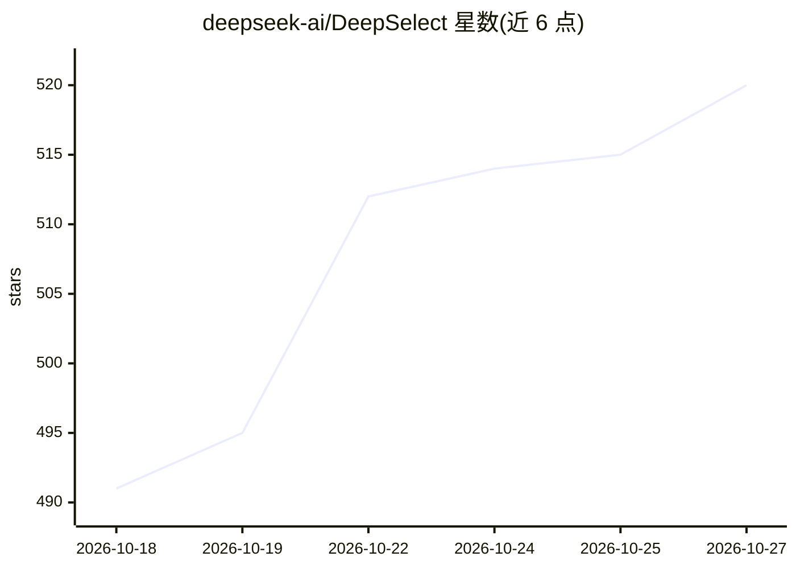

# deepseek-ai/DeepSelect

⭐ 520 · Cuda · MIT · 推送 2026-09-30 · [GitHub](https://github.com/deepseek-ai/DeepSelect) · 组织维护 · 中文 README

**为 DeepSeek 稀疏注意力与采样器定制的高性能 TopK 算子**

面向 DeepSeek Sparse Attention（DSA，用于 DeepSeek V3.2/V4/V4.1 模型）的 Lightning Indexer 场景与采样器场景的 TopK 内核实现，支持 NVIDIA CUDA 与华为昇腾平台，README 报告相较原生 torch.topk 达到 2～20 倍加速。仅覆盖两类受限场景：bfloat16 的索引场景（topk≤4096，主要优化 topk=512）与 float32 的采样场景（词表约 128K，仅 CUDA 支持；昇腾仅支持 bfloat16）。通过 git clone 加 pip 从源码安装，输入张量行需满足字节对齐要求，支持变长行与 NaN 检测中止。

## 筛选速览

| 维度 | 判定 | 备注 |
|---|---|---|
| AI 角色 | `ai-ecosystem` | LLM/agent 周边工具 |
| 许可风险 | `permissive` | MIT |
| 部署形态 | `library` | 以包/库形式分发 |
| 模型依赖 | — | README 未给出锁定关系 |
| 硬件要求 | — | 无带数字的原话,不猜 |
| 安装摩擦 | `medium` | 含编译或系统依赖之一 |
| 成熟度 | — | 结构信号不足 |

## 能力要点

- Lightning Indexer 场景（bfloat16，topk≤4096）与采样场景（float32，词表约 128K）两类 TopK 内核
- 支持 NVIDIA CUDA 与华为昇腾（Ascend）双平台
- 支持变长行（end 参数逐行上界）、NaN 检测中止、自备输出缓冲区

## 适用场景

- 在 DeepSeek V3.2/V4/V4.1 模型推理中替换 DSA 的 TopK 计算
- 采样阶段对约 128K 词表做小 topk 选取
- 在昇腾 NPU 上运行 bfloat16 的 TopK 计算

## 场景标签

`推理引擎` · 领域:训练与推理

## 证据(README 行号)

> L3: DeepSelect is a high performance implementation of the TopK kernel used in DeepSeek Sparse Attention (DSA) (which is
> L5: DeepSelect 是为 DeepSeek 稀疏注意力（DeepSeek Sparse Attention, DSA）和采样器（Sampler）定制的高性能 TopK 算子，支持 NVIDIA CUDA 平台与华为昇腾（Ascen

## 星数曲线

2026-10-18 491 → 2026-10-27 520（+29）

---
*卡片 v1 · prompt 1.4 · 生成 2026-10-21 · 置信度 high · 依据 README sha `d1d833773d6c` · [字段定义](../../DATASET.md)*
