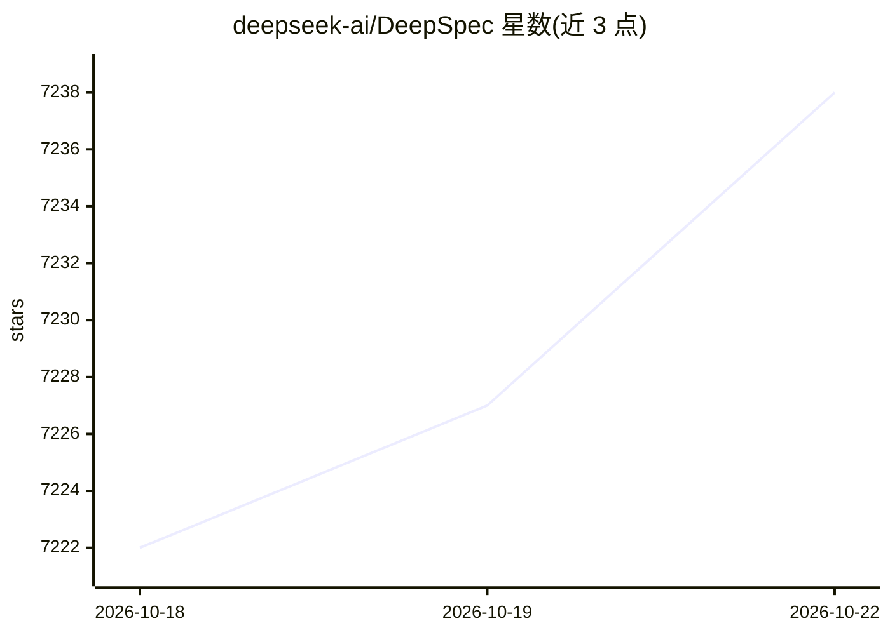

# deepseek-ai/DeepSpec

⭐ 7,243 · Python · MIT · 推送 2026-07-09 · [GitHub](https://github.com/deepseek-ai/DeepSpec) · 组织维护 · 中文 README

**推测解码草稿模型的训练与评测全栈代码库**

DeepSpec 提供推测解码（speculative decoding）中草稿模型（draft model）的训练与评测全流程代码：数据准备（下载提示、重生成目标模型答案、构建目标缓存，默认 Qwen3-4B 设定下缓存约 38 TB）、训练（train.sh 每 GPU 一个 worker）与在 gsm8k、math500、humaneval 等 9 个基准上评测接受率。内置 DSpark、DFlash、Eagle3 三种草稿模型算法，并发布对应 Hugging Face 检查点。默认配置假定单节点 8 GPU。数据准备阶段需额外配置推理引擎服务目标模型。

## 筛选速览

| 维度 | 判定 | 备注 |
|---|---|---|
| AI 角色 | `ai-ecosystem` | LLM/agent 周边工具 |
| 许可风险 | `permissive` | MIT |
| 部署形态 | `library` | 以包/库形式分发 |
| 模型依赖 | — | README 未给出锁定关系 |
| 硬件要求 | — | 无带数字的原话,不猜 |
| 安装摩擦 | `low` | 无编译、无系统依赖或容器化 |
| 成熟度 | — | 结构信号不足 |

## 能力要点

- 数据准备、训练、评测三阶段串联的完整工作流
- 内置 DSpark、DFlash、Eagle3 三种草稿模型算法
- 发布 Qwen3-4B/8B/14B 与 Gemma-4-12B-it 对应的 Hugging Face 检查点
- 支持 gsm8k、math500、livecodebench、arena-hard-v2 等 9 个评测基准

## 适用场景

- 训练推测解码草稿模型以加速目标模型推理
- 在标准基准上评测推测解码的接受率表现
- 复现论文中 DSpark/DFlash/Eagle3 的实验结果

## 场景标签

`微调` `模型评测` · 领域:评测与运维

## 证据(README 行号)

> L3: DeepSpec is a full-stack codebase for training and evaluating draft models for speculative decoding. It contains dat
> L20: 2. **Training** — train a draft model against the cached target outputs.
> L21: 3. **Evaluation** — measure speculative-decoding acceptance on benchmark tasks.

## 星数曲线

2026-10-18 7,222 → 2026-10-22 7,238（+16）

---
*卡片 v1 · prompt 1.4 · 生成 2026-10-20 · 置信度 high · 依据 README sha `9275255ecdf9` · [字段定义](../../DATASET.md)*
