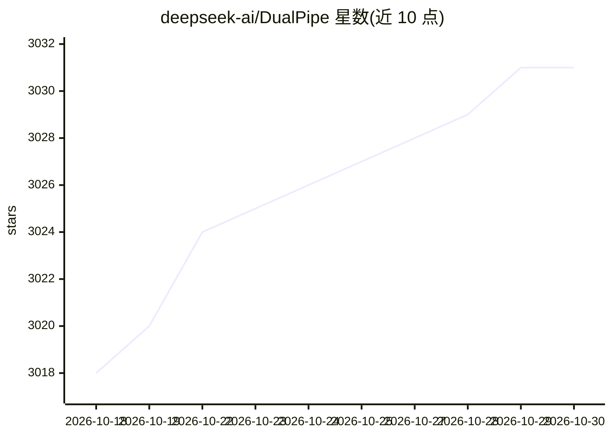

# deepseek-ai/DualPipe

⭐ 3,031 · Python · MIT · 推送 2026-01-14 · [GitHub](https://github.com/deepseek-ai/DualPipe) · 组织维护 · 中文 README

**面向 DeepSeek V3/R1 训练的双向流水线并行算法**

DeepSeek-AI 发布的流水线并行算法实现，用于大模型训练中计算与通信阶段的全重叠并减少流水线气泡。核心是双向调度：8 个 PP rank、20 个 micro-batch 的双向对称调度；另含 Sea AI Lab 派生的 DualPipeV V 形调度（同气泡数下设备数减半，PP*/2）。README 给出与 1F1B、ZB1P 在气泡量与显存占用上的对比表。以 Python 代码与示例脚本提供，需 PyTorch 2.0+；实际应用需为特定模块实现自定义 overlapped_forward_backward 方法。

## 筛选速览

| 维度 | 判定 | 备注 |
|---|---|---|
| AI 角色 | `ai-ecosystem` | LLM/agent 周边工具 |
| 许可风险 | `permissive` | MIT |
| 部署形态 | `None` |  |
| 模型依赖 | — | README 未给出锁定关系 |
| 硬件要求 | — | 无带数字的原话,不猜 |
| 安装摩擦 | `low` | 无编译、无系统依赖或容器化 |
| 成熟度 | — | 结构信号不足 |

## 能力要点

- 双向调度实现前向/反向计算与通信的全重叠
- DualPipeV：V 形调度，同 PP 级数下设备数减半（PP*/2）
- 给出 1F1B/ZB1P/DualPipe/DualPipeV 气泡与显存对比
- 提供可运行的示例脚本（example_dualpipe / dualpipev）

## 适用场景

- 大模型训练中降低流水线并行的气泡开销
- 在受限设备数下采用 DualPipeV 调度训练
- 参考计算-通信重叠的实现做自定义并行扩展

## 场景标签

`模型训练` · 领域:训练与推理

## 证据(README 行号)

> L3: DualPipe is an innovative bidirectional pipeline parallelism algorithm introduced in the DeepSeek-V3 Technical Repor
> L30: |DualPipe|(*PP*/2-1)(𝐹&𝐵+𝐵-3𝑊)|2×|*PP*+1|*PP*|

## 星数曲线

2026-10-18 3,018 → 2026-10-30 3,031（+13）

---
*卡片 v1 · prompt 1.4 · 生成 2026-10-20 · 置信度 high · 依据 README sha `670c91cadaff` · [字段定义](../../DATASET.md)*
