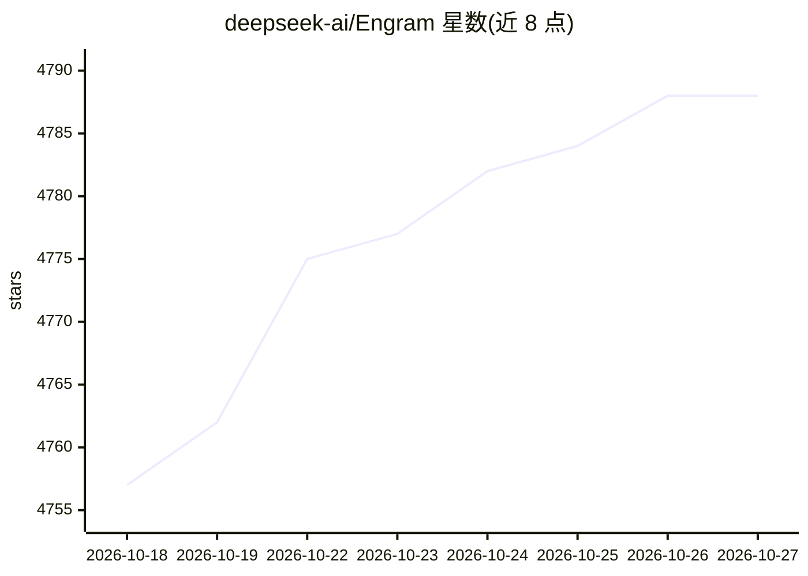

# deepseek-ai/Engram

⭐ 4,788 · Python · Apache-2.0 · 推送 2026-01-14 · [GitHub](https://github.com/deepseek-ai/Engram) · 组织维护

**LLM 条件记忆模块 Engram 的论文官方实现**

DeepSeek 团队发布的论文《Conditional Memory via Scalable Lookup》官方实现：提出 Engram 模块，将经典 N-gram 嵌入现代化为可 O(1) 查找的静态记忆，与 MoE 的条件计算形成互补的稀疏性轴。仓库提供独立演示脚本 engram_demo_v1.py 展示模块核心数据流，其中 Attention/MoE 等组件为 mock 实现。README 阐述了稀疏分配的 U 型缩放律、Engram-27B 的等参数/等 FLOPs 实验及确定式寻址可将嵌入表卸载至主机内存的机制，面向 LLM 架构研究者的读者。

## 筛选速览

| 维度 | 判定 | 备注 |
|---|---|---|
| AI 角色 | `ai-native` | 本体是模型或模型工具 |
| 许可风险 | `permissive` | Apache-2.0 |
| 部署形态 | `library` | 以包/库形式分发 |
| 模型依赖 | locked-api |  |
| 硬件要求 | — | 无带数字的原话,不猜 |
| 安装摩擦 | `low` | 无编译、无系统依赖或容器化 |
| 成熟度 | — | 结构信号不足 |

## 能力要点

- N-gram 嵌入的 O(1) 查找条件记忆模块
- 识别 MoE 神经计算与静态记忆之间的 U 型缩放律
- 确定式寻址支持将大规模嵌入表卸载至主机内存
- 提供独立演示脚本展示 Engram 模块数据流

## 适用场景

- 研究 LLM 中条件记忆与 MoE 的容量分配
- 复现论文中的等参数/等 FLOPs 对比实验
- 了解 Engram 模块的核心数据流实现

## 场景标签

`科研工具` · 领域:学习与行业

## 证据(README 行号)

> L25: This repository contains the official implementation for the paper: **Conditional Memory via Scalable Lookup: A New
> L27: > **Abstract:** While Mixture-of-Experts (MoE) scales capacity via conditional computation, Transformers lack a nat
> L65: We provide a standalone implementation to demonstrate the core logic of the Engram module:

## 星数曲线

2026-10-18 4,757 → 2026-10-27 4,788（+31）

---
*卡片 v1 · prompt 1.4 · 生成 2026-10-20 · 置信度 mid · 依据 README sha `4e7d553cd70f` · [字段定义](../../DATASET.md)*
