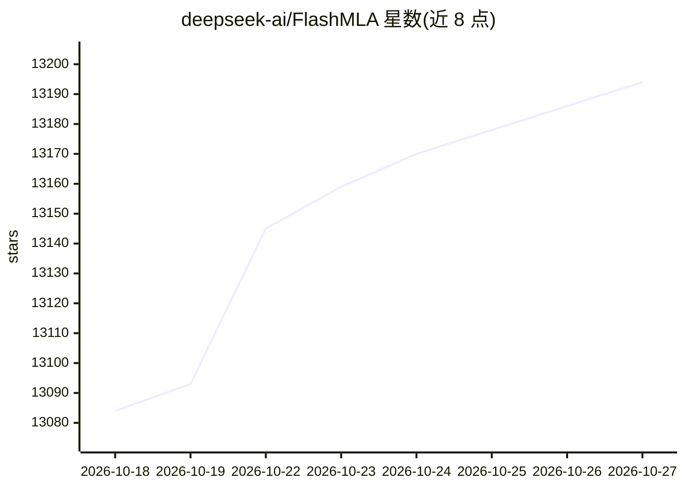

# deepseek-ai/FlashMLA

⭐ 13,194 · C++ · MIT · 推送 2026-10-15 · [GitHub](https://github.com/deepseek-ai/FlashMLA) · 组织维护 · 中文 README

**DeepSeek 的高性能注意力算子库，支撑模型在 GPU/NPU 上推理**

DeepSeek 维护的优化注意力 kernel 库，用于 DeepSeek-V4.1 模型在 NVIDIA GPU 与华为昇腾 NPU 上的推理。提供 token 级稀疏注意力 prefill/decoding 算子（FP8/FP4 KV cache）、融合 Q-norm/Q-RoPE/attention/O-RoPE/FP8 cast 的融合 kernel，以及稠密注意力的 prefill 与反向传播算子。最新版本移除了 Hopper 架构与前代模型支持并更改 KV cache 格式，与旧版不兼容。源码编译安装，要求 SM100/SM103 GPU（CUDA 13.1+）或昇腾 950 NPU（CANN 9.2+）。

## 筛选速览

| 维度 | 判定 | 备注 |
|---|---|---|
| AI 角色 | `ai-ecosystem` | LLM/agent 周边工具 |
| 许可风险 | `permissive` | MIT |
| 部署形态 | `library` | 以包/库形式分发 |
| 模型依赖 | locked-api |  |
| 硬件要求 | — | 无带数字的原话,不猜 |
| 安装摩擦 | `medium` | 含编译或系统依赖之一 |
| 成熟度 | — | 结构信号不足 |

## 能力要点

- token 级稀疏注意力 prefill/decoding 算子（FP8/FP4 KV cache）
- 融合 Q-norm、Q-RoPE、attention、O-RoPE 与 FP8 cast 的融合 kernel
- 同时支持 NVIDIA SM100/SM103 GPU 与华为昇腾 950 NPU
- 稠密注意力 MHA 的 prefill 与反向传播 kernel

## 适用场景

- 为 DeepSeek-V4.1 推理提供注意力 kernel
- 在昇腾 NPU 上运行稀疏注意力计算
- 基准测试与对比注意力算子性能

## 场景标签

`推理引擎` · 领域:训练与推理

## 证据(README 行号)

> L7: FlashMLA is DeepSeek's library of optimized attention kernels, powering inference of the DeepSeek-V4.1 model on NVID
> L9: FlashMLA 是 DeepSeek 的高性能注意力算子库，支撑着 DeepSeek-V4.1 模型在 NVIDIA GPU 与华为昇腾 NPU 上的推理。该仓库支持 prefill 与使用了 FP8 或 FP4 格式的 KV 缓

## 星数曲线

2026-10-18 13,084 → 2026-10-27 13,194（+110）

---
*卡片 v1 · prompt 1.4 · 生成 2026-10-20 · 置信度 high · 依据 README sha `2002539abc5e` · [字段定义](../../DATASET.md)*
