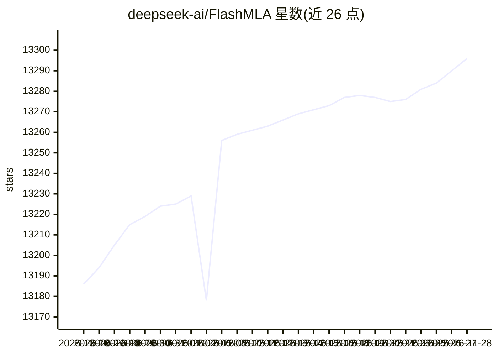

# deepseek-ai/FlashMLA

⭐ 13,296 · C++ · MIT · 推送 2026-11-26 · [GitHub](https://github.com/deepseek-ai/FlashMLA) · 组织维护 · 中文 README

**面向大模型推理的 MLA 稀疏注意力算子库**

DeepSeek 开源的优化注意力算子库，支撑 DeepSeek-V4.1 模型在 NVIDIA GPU 与华为昇腾 NPU 上的推理。包含 token 级稀疏注意力 prefill/decoding 算子（DSA）、融合 norm+RoPE+attention+cast 的单 kernel，以及稠密 attention 的 prefill 与反向传播算子。decoding 仅支持 FP8/FP4 KV cache 格式。通过 git clone 源码编译安装，构建时自动检测 CUDA/昇腾平台。2026.09.30 版本为破坏性变更，移除了 Hopper 架构与前代模型支持，需用旧格式者切换至指定 commit。

## 筛选速览

| 维度 | 判定 | 备注 |
|---|---|---|
| AI 角色 | `ai-ecosystem` | LLM/agent 周边工具 |
| 许可风险 | `permissive` | MIT |
| 部署形态 | `library` | 以包/库形式分发 |
| 模型依赖 | locked-api |  |
| 硬件要求 | — | 无带数字的原话,不猜 |
| 安装摩擦 | `medium` | 含编译或系统依赖之一 |
| 成熟度 | — | 结构信号不足 |

## 能力要点

- token 级稀疏注意力（DSA）的 prefill 与 FP8/FP4 KV cache decoding 算子
- 融合 Q-norm、Q-RoPE、attention、O-RoPE 与 FP8 cast 的单 kernel
- 同时支持 NVIDIA SM100/SM103 GPU 与华为昇腾 950 NPU
- CUDA wheel 基于 abi3，一次编译可跨 PyTorch 2.10+/CPython 3.10+ 使用

## 适用场景

- 为推理 DeepSeek-V4.1 模型接入 MLA 稀疏注意力算子
- 在昇腾 950 NPU 上运行注意力计算
- 为自研推理引擎集成高性能 decoding kernel

## 场景标签

`推理引擎` · 领域:训练与推理

## 证据(README 行号)

> L7: FlashMLA is DeepSeek's library of optimized attention kernels, powering inference of the DeepSeek-V4.1 model on NVID
> L98: ## Installation

## 星数曲线

2026-10-26 13,186 → 2026-11-28 13,296（+110）

---
*卡片 v1 · prompt 1.4 · 生成 2026-11-27 · 置信度 high · 依据 README sha `3f880b1f4c9c` · [字段定义](../../DATASET.md)*
